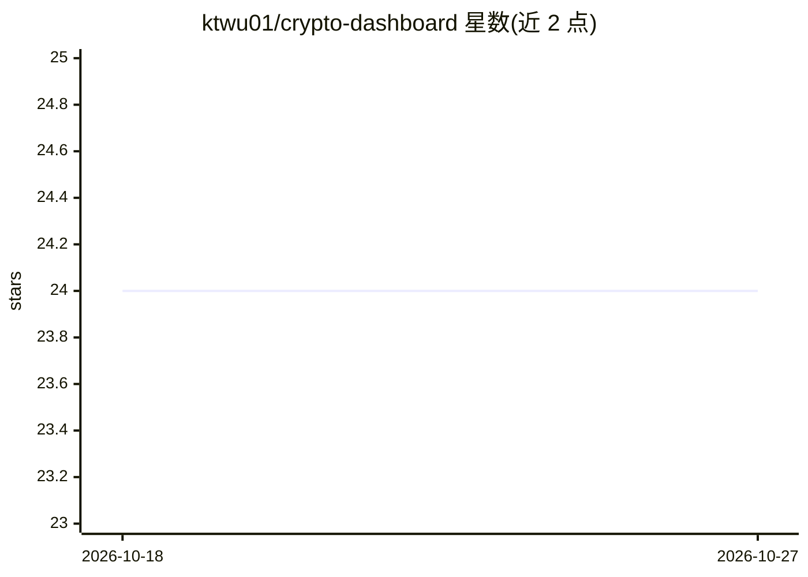

# ktwu01/crypto-dashboard

⭐ 24 · TypeScript · 推送 2026-06-30 · [GitHub](https://github.com/ktwu01/crypto-dashboard) · [官网](https://ktwu01.github.io/crypto-dashboard/) · 个人维护

**加密货币行情与投资组合分析仪表盘，AI 洞察为规划功能**

基于 React 18 + TypeScript + Vite 的加密货币分析仪表盘：通过 CoinGecko API 读取实时价格、全球市值与成交额，展示涨跌幅榜与热门币种；支持添加持仓、查看总价值与盈亏分析；Chart.js 提供多周期交互式价格图表。界面上宣称的 AI Insights 在路线图中仍标记为未完成（L130）。数据默认使用 CoinGecko 免费 API，无需 key，可用 pnpm/npm 本地运行。

## 筛选速览

| 维度 | 判定 | 备注 |
|---|---|---|
| AI 角色 | `ai-enhanced` | 去掉 AI 部分产品仍成立 |
| 许可风险 | `none` | — |
| 部署形态 | `library` | 以包/库形式分发 |
| 模型依赖 | — | README 未给出锁定关系 |
| 硬件要求 | — | 无带数字的原话,不猜 |
| 安装摩擦 | `low` | 无编译、无系统依赖或容器化 |
| 成熟度 | — | 结构信号不足 |

## 能力要点

- CoinGecko API 实时价格、市值与热门币种追踪
- 持仓管理与总价值、盈亏、配置分析
- Chart.js 多周期交互图表（24h 至 max）

## 适用场景

- 跟踪加密货币实时行情与涨跌榜
- 管理并查看自己的持仓盈亏
- 在多周期图表中查看币价走势

## 场景标签

 · 领域:金融/加密货币工具

## 证据(README 行号)

> L14: *AI Insights sit at the top of the streamlined dashboard, surfacing the latest market pulse alongside high-level pe
> L130: - [ ] AI-powered market insights

## 星数曲线

2026-10-18 24 → 2026-10-27 24（+0）

---
*卡片 v1 · prompt 1.4 · 生成 2026-10-27 · 置信度 low · 依据 README sha `e57e7a7dc7c2` · [字段定义](../../DATASET.md)*
