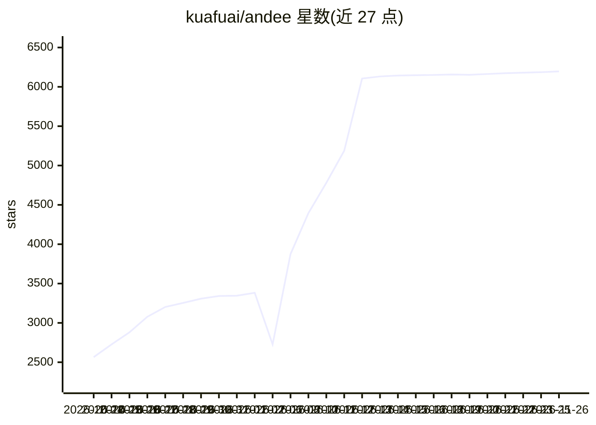

# kuafuai/andee

⭐ 6,196 · Kotlin · NOASSERTION · 推送 2026-11-24 · [GitHub](https://github.com/kuafuai/andee) · [官网](https://heyandee.com) · 组织维护 · 中文 README

**住进手机/Mac 的个人 agent，像人一样操作任意 App**

Andee 是运行在 Android 手机/平板与 Mac 上的个人 agent：通过读取屏幕、点击、输入来操作任意 App，无需应用侧集成、无需 Root。它把长任务交给 Mac 端的 DeepSeek Harness 助手并继续与用户对话，主动跟踪任务状态、预读通知、以设备本地的记事本保存记忆，密码经本地 vault 输入、不回读。安装方式为 CodeFlying 在线构建或 GitHub 下载 APK/DMG，release 包不含密钥，需自行填入模型/语音 key 或切换本地模式。README 声明项目为实验性质、无 SLA，并披露调试 WebSocket 端口无鉴权等已知限制。

## 筛选速览

| 维度 | 判定 | 备注 |
|---|---|---|
| AI 角色 | `ai-native` | 本体是模型或模型工具 |
| 许可风险 | `none` | NOASSERTION |
| 部署形态 | `desktop` | 安装包/桌面程序 |
| 模型依赖 | — | README 未给出锁定关系 |
| 硬件要求 | — | 无带数字的原话,不猜 |
| 安装摩擦 | `low` | 无编译、无系统依赖或容器化 |
| 成熟度 | `idea` | |

## 能力要点

- 屏幕读取+点击方式操作任意手机 App，无需应用集成或 Root
- 长任务下放 Mac 端助手（DeepSeek Harness），主对话不中断
- 记忆与密码存于设备本地，无 analytics SDK
- 任务清单跟踪、通知预读摘要、主动收尾可开关

## 适用场景

- 让 agent 代你在手机 App 里完成点击、输入类操作
- 把耗时长的调研/文件处理交给 Mac 端助手后台跑
- 让 agent 帮你过滤通知并跟进未完成的承诺

## 场景标签

`AI 助手` `GUI 自动化` · 领域:效率与自动化

## 证据(README 行号)

> L53: ## Andee is a personal agent
> L55: Tell it what you want. It does it on your phone and on your Mac, the way you would: it opens the app, taps, types,
> L112: It lives in two places today, an Android phone or tablet and a Mac, and it can drive a small robot dog. It is the

## 星数曲线

2026-10-24 2,565 → 2026-11-26 6,196（+3,631）

---
*卡片 v1 · prompt 1.4 · 生成 2026-11-26 · 置信度 high · 依据 README sha `6ae59bb2393e` · [字段定义](../../DATASET.md)*
