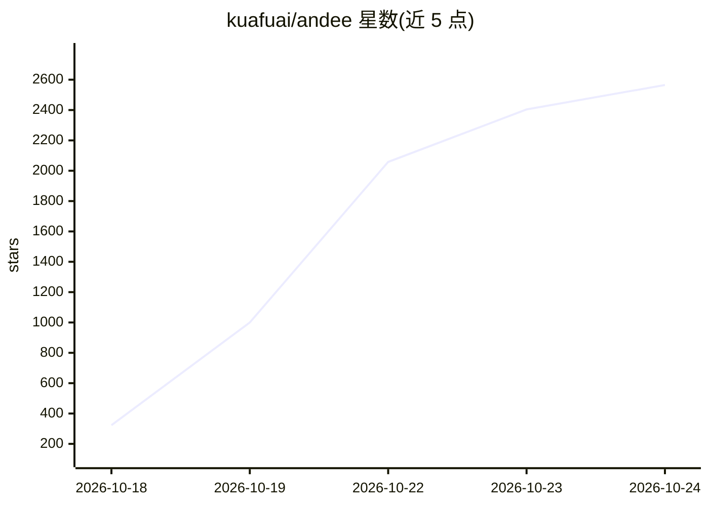

# kuafuai/andee

⭐ 2,727 · Kotlin · NOASSERTION · 推送 2026-10-24 · [GitHub](https://github.com/kuafuai/andee) · [官网](https://heyandee.com) · 组织维护 · 中文 README

**驻留 Android 手机、跨应用代为操作的端上个人 agent**

单个 APK 安装的 Android 应用，以 AccessibilityService 读取屏幕元素与截图、通过 8×12 标注网格定位点击，从而在任意应用内代替用户点按、输入、读通知、发短信、管理订阅等，无需应用方做任何集成。思考与记忆均在设备本地：对话可指向任意 OpenAI 兼容模型（英文默认 OpenAI，中文默认 DeepSeek），笔记本记忆 localOnly 不上传；语音经所选语音服务商（默认火山）离开设备。支持场景（scenes）、本地 Keystore 密码库（只代填不外泄）、调度器与通知分类。仅支持 Android，无需 root；项目自述为实验性、无保证。

## 筛选速览

| 维度 | 判定 | 备注 |
|---|---|---|
| AI 角色 | `ai-native` | 本体是模型或模型工具 |
| 许可风险 | `none` | NOASSERTION |
| 部署形态 | `None` |  |
| 模型依赖 | — | README 未给出锁定关系 |
| 硬件要求 | — | 无带数字的原话,不猜 |
| 安装摩擦 | `medium` | 含编译或系统依赖之一 |
| 成熟度 | `idea` | |

## 能力要点

- 读无障碍树+截图，按标注网格定位，任意应用无集成即可操作
- 本地笔记本记忆 localOnly 不出设备，条目可查看可删除
- Keystore AES-GCM 密码库：可代填密码但任何工具不会返回密码
- 支付最终确认与输密码等边界规则写在 dispatcher 而非提示词

## 适用场景

- 让 agent 代我在各类 App 里完成订阅取消、定时抢订等操作
- 跨聊天应用统一阅读通知并筛出需要我处理的内容
- 录制会议并生成含行动项的纪要

## 场景标签

`GUI 自动化` `Agent 记忆` · 领域:Agent 开发

## 证据(README 行号)

> L40: **It is not here to help you use your phone. It is here to be the thing that lives in it.** Once it is
> L47: - **It lives in the device, not in a vendor's cloud.** The brain runs on the device itself, against any
> L62: - **Works in every app — and needs nothing from the app.** No intent to expose, no SDK to adopt, no

## 星数曲线

2026-10-18 323 → 2026-10-24 2,565（+2,242）

---
*卡片 v1 · prompt 1.4 · 生成 2026-10-21 · 置信度 high · 依据 README sha `d16fc680a110` · [字段定义](../../DATASET.md)*
