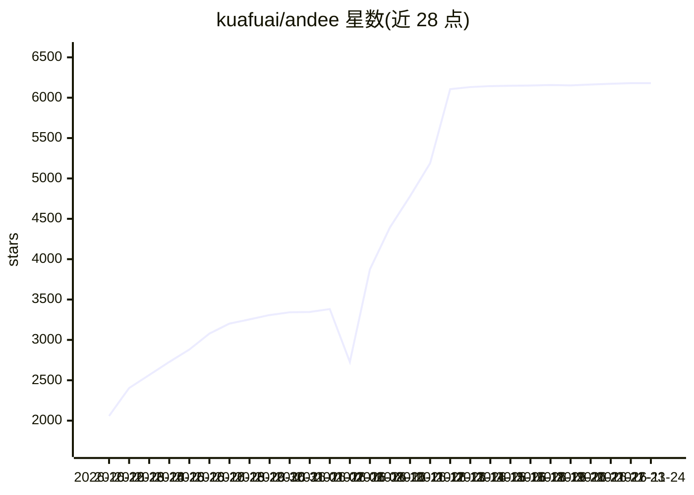

# kuafuai/andee

⭐ 6,180 · Kotlin · NOASSERTION · 推送 2026-11-20 · [GitHub](https://github.com/kuafuai/andee) · [官网](https://heyandee.com) · 组织维护 · 中文 README

**住进手机/Mac 的个人 agent：像人一样操作任意 App**

以 Android APK 与 Mac 应用的形式运行的个人 agent：通过读屏、点击、输入的方式操作任意手机应用，无需应用集成、无需 Root；Mac 上还可使用窗口与终端。支持任务清单跟踪、设备本地记忆笔记、不暴露密码的保险库代填登录，以及把长任务交给 Mac 上的助手 agent（DeepSeek Harness）。安装方式为 CodeFlying 在线构建、GitHub Release 下载 APK/DMG，或从源码构建；语音与模型后端可自行配置密钥。

## 筛选速览

| 维度 | 判定 | 备注 |
|---|---|---|
| AI 角色 | `ai-native` | 本体是模型或模型工具 |
| 许可风险 | `none` | NOASSERTION |
| 部署形态 | `desktop` | 安装包/桌面程序 |
| 模型依赖 | — | README 未给出锁定关系 |
| 硬件要求 | — | 无带数字的原话,不猜 |
| 安装摩擦 | `low` | 无编译、无系统依赖或容器化 |
| 成熟度 | — | 结构信号不足 |

## 能力要点

- 读屏+模拟点击操作任意手机应用，无需集成与 Root
- 记忆笔记与密码保险库留在本地设备
- 长任务可分派给 Mac 上的助手 agent
- 提供无遥测声明与 SECURITY.md 已知限制文档

## 适用场景

- 让 agent 替我完成手机 App 里的日常操作
- 把耗时的研究或文件任务交给 Mac 助手继续后台执行
- 不用把密码交给工具就完成登录
- 过滤通知并只汇报重要信息

## 场景标签

`GUI 自动化` `AI 助手` · 领域:效率与自动化

## 证据(README 行号)

> L55: Tell it what you want. It does it on your phone and on your Mac, the way you would: it opens the app, taps, types,
> L82: - **Any app, nothing to set up in the app.** It looks at the screen and taps like you do. On the Mac it also uses
> L112: It lives in two places today, an Android phone or tablet and a Mac, and it can drive a small robot dog. It is the

## 星数曲线

2026-10-22 2,058 → 2026-11-24 6,180（+4,122）

---
*卡片 v1 · prompt 1.4 · 生成 2026-11-22 · 置信度 high · 依据 README sha `6415d4b3e4e8` · [字段定义](../../DATASET.md)*
