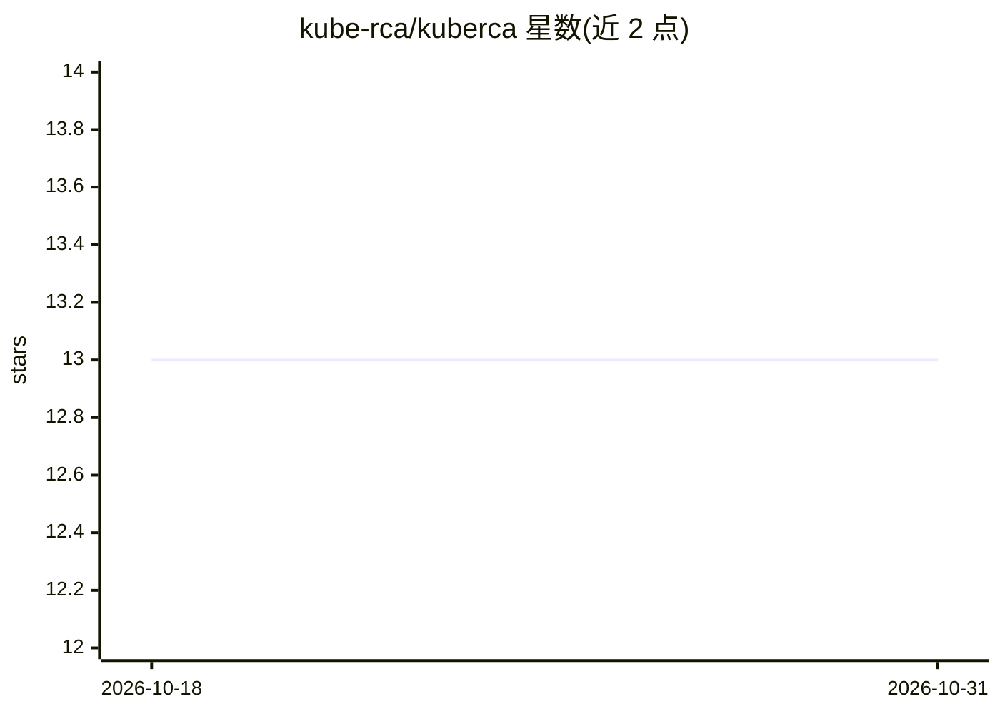

# kube-rca/kuberca

⭐ 13 · Go · Apache-2.0 · 推送 2026-09-30 · [GitHub](https://github.com/kube-rca/kuberca) · 组织维护

**面向 Kubernetes 运维者的 AI 告警根因分析平台**

接收 Alertmanager webhook 告警，自动聚合成 incident，Agent 采集 Kubernetes/Prometheus/Tempo 上下文后调用 LLM（Gemini/OpenAI/Anthropic 可选）生成含根因、影响与建议的 RCA 摘要，推送到 Slack 线程与 React 看板（SSE 实时更新）。已解决的 incident 会生成摘要与向量（PostgreSQL+pgvector）以支持相似事件检索。通过 Helm chart 部署，Slack、Tempo、OIDC 均为可选；不定位为自治修复引擎或 APM 替代品。

## 筛选速览

| 维度 | 判定 | 备注 |
|---|---|---|
| AI 角色 | `ai-native` | 本体是模型或模型工具 |
| 许可风险 | `permissive` | Apache-2.0 |
| 部署形态 | `library` | 以包/库形式分发 |
| 模型依赖 | — | README 未给出锁定关系 |
| 硬件要求 | — | 无带数字的原话,不猜 |
| 安装摩擦 | `low` | 无编译、无系统依赖或容器化 |
| 成熟度 | — | 结构信号不足 |

## 能力要点

- Alertmanager webhook 接入并自动关联 incident 与告警
- 采集 K8s/Prometheus/Tempo 上下文后由 LLM 生成 RCA 摘要，推送 Slack 线程
- incident 摘要向量化存入 PostgreSQL+pgvector，支持相似事件检索
- Helm chart 一键部署全栈，支持本地认证或 Google OIDC

## 适用场景

- 值班运维收到告警后快速获得根因分析与处置建议
- 团队在 Slack 线程或看板上跟踪与复盘 incident
- 检索历史相似事件复用排查经验

## 场景标签

 · 领域:云计算/可观测性与事故响应

## 证据(README 行号)

> L5:  AI-powered Kubernetes incident analysis and Root Cause Analysis
> L38: Each firing alert posts to Slack, and the LLM-generated RCA summary (root cause, impact, recommended action) is add
> L100: |RCA generation|Backend calls the Agent, which collects Kubernetes and observability context and runs LLM analysis

## 星数曲线

2026-10-18 13 → 2026-10-31 13（+0）

---
*卡片 v1 · prompt 1.4 · 生成 2026-10-31 · 置信度 high · 依据 README sha `d0ecfb951d50` · [字段定义](../../DATASET.md)*
