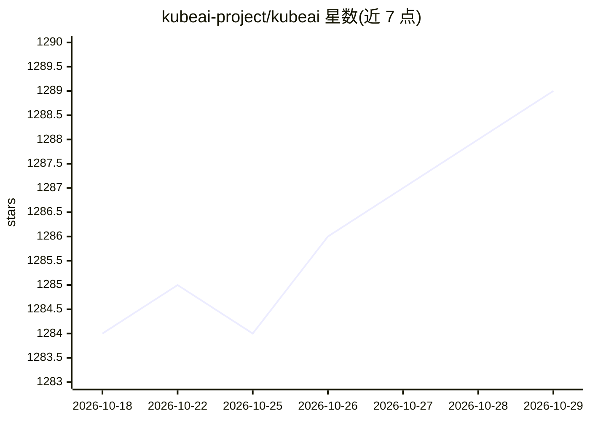

# kubeai-project/kubeai

⭐ 1,289 · Go · Apache-2.0 · 推送 2026-10-27 · [GitHub](https://github.com/kubeai-project/kubeai) · [官网](https://www.kubeai.org) · 组织维护

**Kubernetes 上的 AI 推理算子：部署与弹性伸缩 LLM/嵌入/语音模型**

KubeAI 是一个 Kubernetes Operator，由两部分组成：OpenAI 兼容的模型代理（实现前缀感知负载均衡以优化后端引擎 KV cache 利用、请求排队与重试）与模型算子（通过 Model CRD 管理后端 Pod，自动下载模型、挂载卷、加载 LoRA 适配器）。支持 vLLM 与 Ollama 服务、FasterWhisper 语音转写、Infinity 嵌入与 reranking，支持从零扩缩容，不依赖 Istio/Knative/Prometheus adapter，可在 CPU/GPU/TPU 运行。通过 Helm 安装，附带预配置模型目录与内置 chat UI（open-webui）。

## 筛选速览

| 维度 | 判定 | 备注 |
|---|---|---|
| AI 角色 | `ai-ecosystem` | LLM/agent 周边工具 |
| 许可风险 | `permissive` | Apache-2.0 |
| 部署形态 | `library` | 以包/库形式分发 |
| 模型依赖 | local-ok | 支持本地模型 |
| 硬件要求 | `cpu-ok` | |
| 安装摩擦 | `low` | 无编译、无系统依赖或容器化 |
| 成熟度 | — | 结构信号不足 |

## 能力要点

- OpenAI 兼容代理：前缀感知负载均衡、请求排队与重试
- 通过 Model CRD 自动化模型下载、卷挂载与 LoRA 适配器编排
- 从零扩缩容，不依赖 Istio/Knative 等其他系统
- 支持 vLLM/Ollama/FasterWhisper/Infinity 后端，运行于 CPU/GPU/TPU

## 适用场景

- 在 Kubernetes 集群上运维 LLM 推理服务并按需扩缩容
- 以 OpenAI 兼容 API 统一代理多个后端模型服务
- 为搜索系统生成嵌入与 reranking 服务

## 场景标签

`推理引擎` `模型网关` · 领域:Agent 开发

## 证据(README 行号)

> L3: Deploy and scale machine learning models on Kubernetes.
> L65: **1. The model proxy:** the KubeAI proxy provides an OpenAI-compatible API. Behind this API, the proxy implements a
> L67: **2. The model operator:** the KubeAI model operator manages backend server Pods directly. It automates common oper

## 星数曲线

2026-10-18 1,284 → 2026-10-29 1,289（+5）

---
*卡片 v1 · prompt 1.4 · 生成 2026-10-21 · 置信度 high · 依据 README sha `6aca4bb43cff` · [字段定义](../../DATASET.md)*
