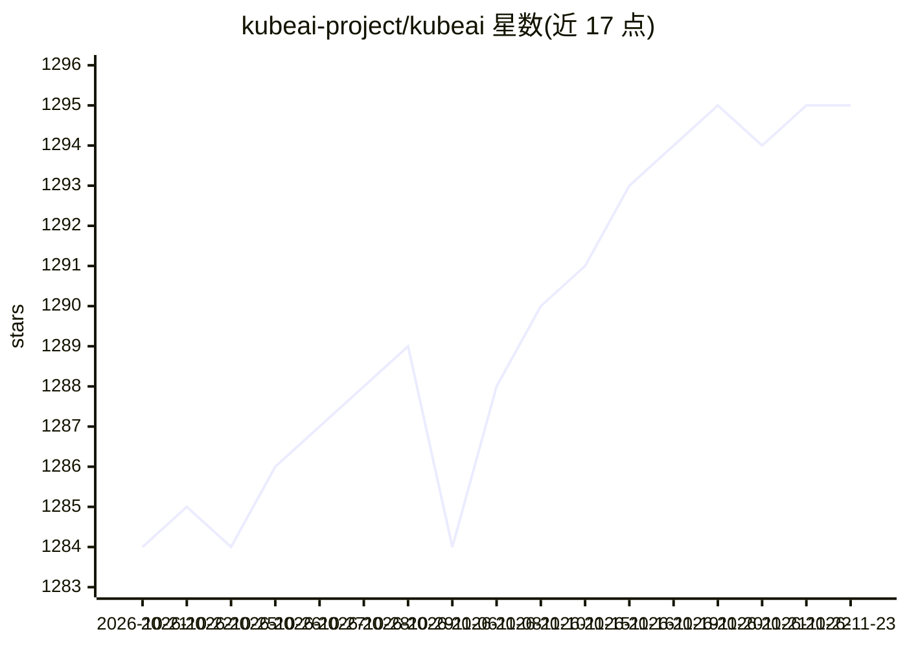

# kubeai-project/kubeai

⭐ 1,295 · Go · Apache-2.0 · 推送 2026-11-22 · [GitHub](https://github.com/kubeai-project/kubeai) · [官网](https://www.kubeai.org) · 组织维护

**Kubernetes 上的 AI 推理 Operator：运行/扩缩 LLM 等模型**

部署在 Kubernetes 上的 AI 推理系统，由两部分组成：提供 OpenAI 兼容 API 的模型代理（实现前缀感知负载均衡以优化后端 KV cache 利用，支持请求排队与重试）和通过 Model CRD 直接管理后端 Pod 的模型 Operator（自动化模型下载、卷挂载、LoRA 动态适配器加载）。支持从零扩缩、模型缓存与消息流集成，不依赖 Istio/Knative。安装通过 Helm，本地可用 kind/minikube 快速体验，附聊天 UI。

## 筛选速览

| 维度 | 判定 | 备注 |
|---|---|---|
| AI 角色 | `ai-ecosystem` | LLM/agent 周边工具 |
| 许可风险 | `permissive` | Apache-2.0 |
| 部署形态 | `library` | 以包/库形式分发 |
| 模型依赖 | local-ok | 支持本地模型 |
| 硬件要求 | `cpu-ok` | |
| 安装摩擦 | `low` | 无编译、无系统依赖或容器化 |
| 成熟度 | — | 结构信号不足 |

## 能力要点

- OpenAI 兼容 API（chat/completions、completions、embeddings）
- 前缀感知负载均衡，优化后端 KV cache 利用率
- Model CRD 管理模型下载、卷挂载与 LoRA 适配器
- 支持从零扩缩，不依赖 Istio/Knative 等外部系统

## 适用场景

- 在 Kubernetes 集群中运行并弹性扩缩 LLM 服务
- 通过 OpenAI 客户端库直接接入集群内模型推理
- 对 vLLM 多副本部署做负载均衡优化
- 在集群中提供 embeddings、reranking 与语音转录服务

## 场景标签

`语音识别` `推理引擎` · 领域:感知与多模态

## 证据(README 行号)

> L1: # KubeAI: AI Inferencing Operator
> L11: 🚀 **LLM Inferencing** - Operate vLLM and Ollama servers
> L65: **1. The model proxy:** the KubeAI proxy provides an OpenAI-compatible API. Behind this API, the proxy implements a

## 星数曲线

2026-10-21 1,284 → 2026-11-23 1,295（+11）

---
*卡片 v1 · prompt 1.4 · 生成 2026-11-23 · 置信度 high · 依据 README sha `6712e411196d` · [字段定义](../../DATASET.md)*
