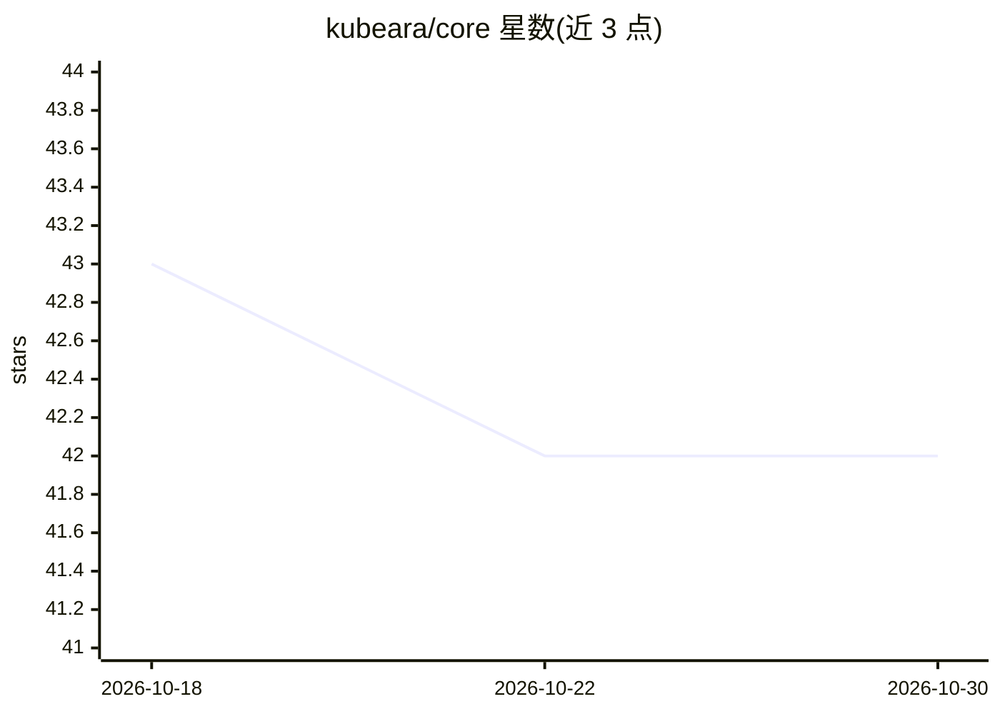

# kubeara/core

⭐ 42 · TypeScript · MIT · 推送 2026-10-28 · [GitHub](https://github.com/kubeara/core) · [官网](https://kubeara.dev/) · 个人维护

**自托管 PaaS：在自有服务器上一键部署 200+ 服务与 AI 模型**

面向私有基础设施的开源部署平台（MIT）：通过 SSH 连接服务器，从 200+ 经过自动化验证的模板一键部署数据库、应用与 AI 模型。内置容器级 GPU 监控、模型拉取前 VRAM 校验、Ollama 一键部署、原生 MCP server（可用 Claude、Cursor 等 MCP 客户端管理基础设施）、基于 agent 的出站连接安全模型。提供自托管（免费）与托管云（含付费计划）两种使用方式；安装走 curl 脚本或 docker compose。

## 筛选速览

| 维度 | 判定 | 备注 |
|---|---|---|
| AI 角色 | `ai-ecosystem` | LLM/agent 周边工具 |
| 许可风险 | `permissive` | MIT |
| 部署形态 | `self-host` | docker 或自建部署 |
| 模型依赖 | local-ok | 支持本地模型 |
| 硬件要求 | — | 无带数字的原话,不猜 |
| 安装摩擦 | `low` | 无编译、无系统依赖或容器化 |
| 成熟度 | — | 结构信号不足 |

## 能力要点

- 200+ 经自动化部署验证的模板，一键部署
- 容器级 GPU/VRAM/温度监控与模型拉取前 VRAM 校验
- Ollama 与 AI 模型的面板化部署管理
- 原生 MCP server，可通过 Claude、Cursor 等 MCP 客户端管理基础设施

## 适用场景

- 在自有服务器上一键部署数据库、应用和 AI 模型
- 需要 GPU 利用率与 VRAM 监控的 AI 模型运维
- 通过 MCP 客户端（Claude/Cursor）管理部署基础设施
- 替代 Coolify/Heroku 等托管平台的私有化部署

## 场景标签

 · 领域:DevOps/基础设施部署

## 证据(README 行号)

> L57: |**AI model management**|Pull, switch, and delete AI models from the dashboard. No SSH. No terminal commands.|
> L58: |**MCP integration**|Native MCP server. Manage infrastructure through Claude, Cursor, or any MCP-compatible client.
> L178: * One-click Ollama and AI model deployment

## 星数曲线

2026-10-18 43 → 2026-10-30 42（-1）

---
*卡片 v1 · prompt 1.4 · 生成 2026-10-25 · 置信度 high · 依据 README sha `34616c919cde` · [字段定义](../../DATASET.md)*
