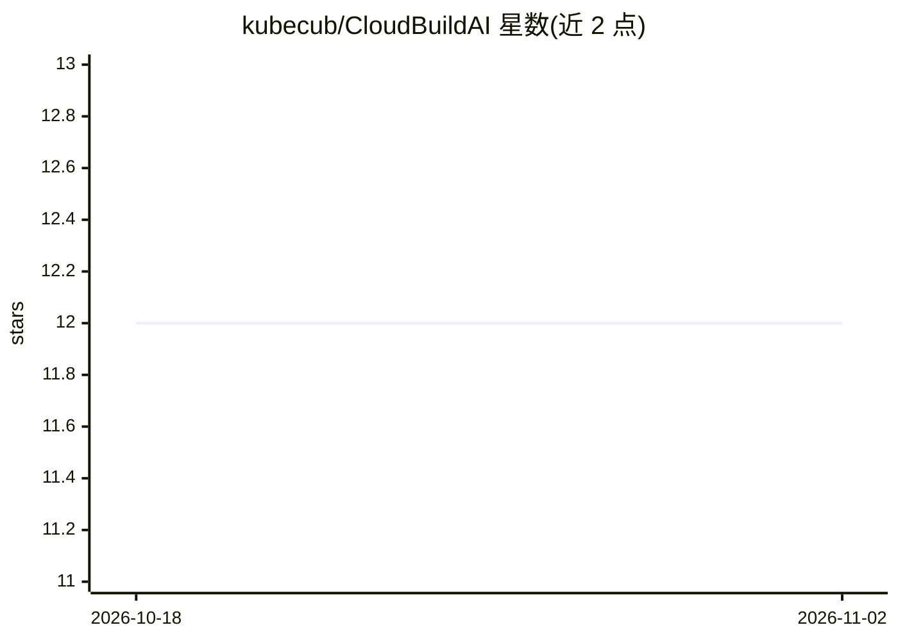

# kubecub/CloudBuildAI

⭐ 12 · Go · MIT · 推送 2026-10-31 · [GitHub](https://github.com/kubecub/CloudBuildAI) · [官网](https://kubecub.github.io/CloudBuildAI/) · 组织维护 · 中文 README

**输入 GitHub 仓库地址，AI 自动生成 Dockerfile 与 K8s 部署文件**

面向云原生开发者的自动化构建部署工具：用户提交 GitHub 仓库地址后，系统分析代码并生成 Dockerfile、Kubernetes YAML 等部署配置，可自动部署到 Sealos；生成不准确时通过自动修复与人工反馈持续优化。实现基于 Auto-GPT（需 OpenAI API key 与 Pinecone API key，支持 GPT-4/GPT-3.5），并配合 k8sgpt（Go 1.20 编译）进行集群分析。项目采用 MVC 架构，README 自述为开发中的预览版本。

## 筛选速览

| 维度 | 判定 | 备注 |
|---|---|---|
| AI 角色 | `ai-native` | 本体是模型或模型工具 |
| 许可风险 | `permissive` | MIT |
| 部署形态 | `self-host` | docker 或自建部署 |
| 模型依赖 | — | README 未给出锁定关系 |
| 硬件要求 | — | 无带数字的原话,不猜 |
| 安装摩擦 | `low` | 无编译、无系统依赖或容器化 |
| 成熟度 | `idea` | |

## 能力要点

- 输入 GitHub 仓库地址自动生成 Dockerfile 与 Kubernetes YAML
- 通过自动修复与人工反馈持续优化生成准确度
- 基于 Auto-GPT（OpenAI GPT-4/GPT-3.5）与 k8sgpt 构建
- 支持在 Sealos 上自动部署应用

## 适用场景

- 我提交仓库地址就能拿到可用的 Dockerfile 和 K8s 部署文件
- 为应用生成部署配置并自动部署到 Sealos 集群
- 对生成结果反馈后让系统迭代修正配置

## 场景标签

`代码生成` · 领域:编码与开发

## 证据(README 行号)

> L13: CloudBuildAI is an automated cloud-native application building and deployment tool that uses AI technology to gener
> L17: CloudBuildAI can automatically generate Dockerfiles and Kubernetes deployment files by inputting a GitHub repositor
> L30: 2. CloudBuildAI analyzes the code and generates Dockerfile and Kubernetes YAML files

## 星数曲线

2026-10-18 12 → 2026-11-02 12（+0）

---
*卡片 v1 · prompt 1.4 · 生成 2026-11-01 · 置信度 mid · 依据 README sha `fbcb3603668e` · [字段定义](../../DATASET.md)*
