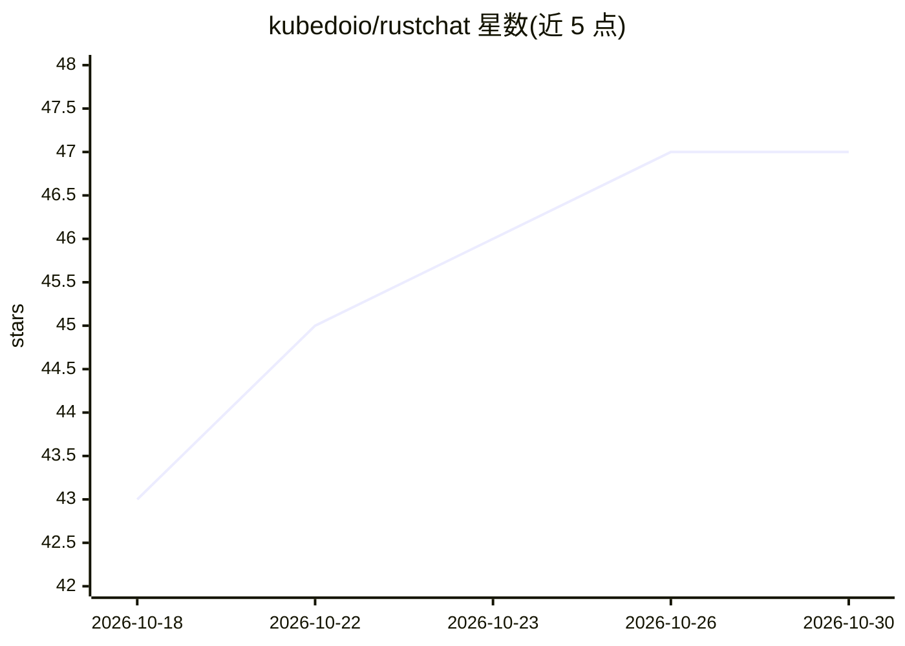

# kubedoio/rustchat

⭐ 47 · Rust · Apache-2.0 · 推送 2026-10-26 · [GitHub](https://github.com/kubedoio/rustchat) · [官网](https://rustchat.io) · 组织维护

**自托管团队聊天与协作基础设施（含 AI Agent 功能）**

Rust 后端 + Vue 前端的自托管通信系统，提供频道、线程、私聊、文件共享、语音视频通话（SFU）、搜索、SSO/RBAC、审计日志与 API key。兼容 Mattermost API v4，可复用 Mattermost 移动端。AI 相关：Agent Runtime 以频道成员身份响应消息（OpenAI 或自定义模型）、基于 pgvector 的 RAG 知识库（S3/RustShare 同步）、Tavily 网络搜索工具、Agent 用量分析与用户反馈。Docker Compose 一键部署，最低 2GB 内存。当前处于 Public Preview / Pre-Release，SAML/LDAP、插件等仍为部分实现。

## 筛选速览

| 维度 | 判定 | 备注 |
|---|---|---|
| AI 角色 | `ai-enhanced` | 去掉 AI 部分产品仍成立 |
| 许可风险 | `permissive` | Apache-2.0 |
| 部署形态 | `self-host` | docker 或自建部署 |
| 模型依赖 | — | README 未给出锁定关系 |
| 硬件要求 | — | 无带数字的原话,不猜 |
| 安装摩擦 | `low` | 无编译、无系统依赖或容器化 |
| 成熟度 | `idea` | |

## 能力要点

- 频道/线程/文件/语音视频通话/搜索的完整团队通信功能
- AI Agent 以原生频道成员参与对话，支持 OpenAI 或自定义模型
- pgvector 语义索引的 RAG 知识库，S3 或本地目录同步
- Mattermost API v4 兼容，可复用其移动端应用

## 适用场景

- 技术团队自托管掌控通信数据的团队聊天
- 把 AI 助手接入团队频道回答问题并检索知识库
- 通过 Docker Compose 在小规格 VPS 上部署协作平台

## 场景标签

`AI 助手` `RAG` · 领域:对话与助手

## 证据(README 行号)

> L71: - **AI Agents** — Custom AI assistants acting as native channel participants responding to mentions or all messages
> L72: - **RAG Knowledge Bases** — Sync documents from S3 or external folders (via RustShare) with PGVector semantic searc
> L252: - AI Agent runtime with OpenAI (or custom model overrides) integration

## 星数曲线

2026-10-18 43 → 2026-10-30 47（+4）

---
*卡片 v1 · prompt 1.4 · 生成 2026-10-25 · 置信度 high · 依据 README sha `ed454089fd80` · [字段定义](../../DATASET.md)*
