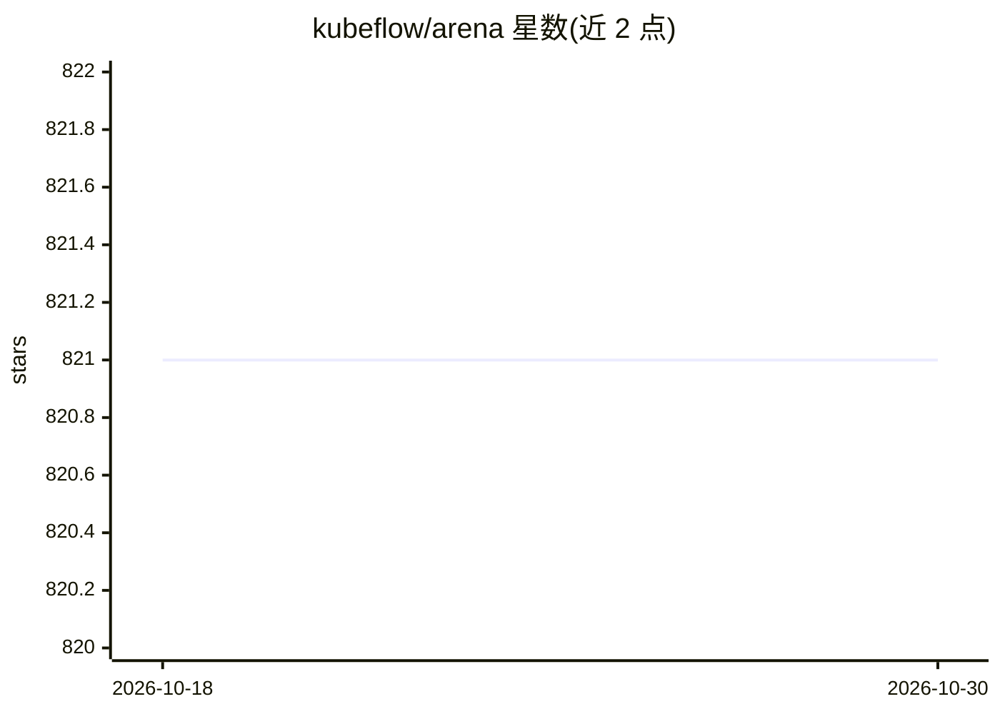

# kubeflow/arena

⭐ 821 · Go · Apache-2.0 · 推送 2026-09-25 · [GitHub](https://github.com/kubeflow/arena) · [官网](https://arena-docs.readthedocs.io) · 组织维护 · 中文 README

**面向数据科学家的 Kubernetes 机器学习训练任务 CLI**

Arena 是 Kubeflow 项目下的命令行工具，供数据科学家在 Kubernetes 集群上提交、监控机器学习训练任务并查看结果，支持单机与分布式 TensorFlow 训练，后端基于 Kubernetes、Helm 与 Kubeflow，用户无需深入了解 Kubernetes。另提供 top 命令查看集群可用 GPU 资源。开发者可用 Go 从源码构建二进制，并支持 CPU profiling 分析。提供中文文档链接。

## 筛选速览

| 维度 | 判定 | 备注 |
|---|---|---|
| AI 角色 | `ai-ecosystem` | LLM/agent 周边工具 |
| 许可风险 | `permissive` | Apache-2.0 |
| 部署形态 | `None` |  |
| 模型依赖 | — | README 未给出锁定关系 |
| 硬件要求 | — | 无带数字的原话,不猜 |
| 安装摩擦 | `low` | 无编译、无系统依赖或容器化 |
| 成熟度 | — | 结构信号不足 |

## 能力要点

- 支持单机/分布式 TensorFlow 训练任务的提交与监控
- 基于 Kubernetes、Helm 与 Kubeflow，屏蔽底层细节
- top 命令查看集群可用 GPU 资源
- Go 源码构建，内置 CPU profiling（pprof）

## 适用场景

- 数据科学家在 GPU 集群上运行和监控训练任务
- 查看 Kubernetes 集群中可用的 GPU 资源
- 在不熟悉 Kubernetes 的情况下管理分布式训练

## 场景标签

`MLOps` · 领域:训练与推理

## 证据(README 行号)

> L9: Arena is a command-line interface for the data scientists to run and monitor the machine learning training jobs and 
> L13: In one word, Arena's goal is to make the data scientists feel like to work on a single machine but with the Power o

## 星数曲线

2026-10-18 821 → 2026-10-30 821（+0）

---
*卡片 v1 · prompt 1.4 · 生成 2026-10-21 · 置信度 high · 依据 README sha `12a2d3f583a1` · [字段定义](../../DATASET.md)*
