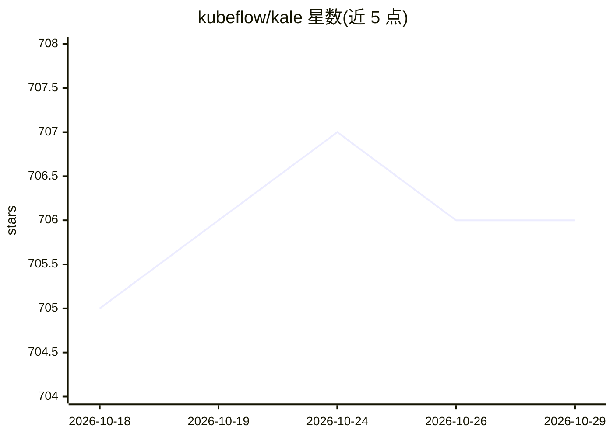

# kubeflow/kale

⭐ 706 · Python · Apache-2.0 · 推送 2026-10-27 · [GitHub](https://github.com/kubeflow/kale) · [官网](https://kale.kubeflow.org/) · 组织维护

**给数据科学家：一键将 Jupyter Notebook 转为 Kubeflow 流水线**

KALE（Kubeflow Automated pipeLines Engine）简化 Kubeflow Pipelines 工作流部署：用户在 Jupyter 单元格上打标签（imports/step/skip 等），Kale 分析代码、自动检测步骤间依赖，生成可直接运行的 Kubeflow Pipeline，无需学习 KFP SDK 或改写代码。以 JupyterLab 扩展与 CLI 两种形式提供，支持 PyPI 安装、源码构建与 Docker 本地运行。运行要求 Python 3.11+、Kubeflow Pipelines v2.16.0+ 与 Kubernetes 集群。

## 筛选速览

| 维度 | 判定 | 备注 |
|---|---|---|
| AI 角色 | `ai-ecosystem` | LLM/agent 周边工具 |
| 许可风险 | `permissive` | Apache-2.0 |
| 部署形态 | `library` | 以包/库形式分发 |
| 模型依赖 | — | README 未给出锁定关系 |
| 硬件要求 | — | 无带数字的原话,不猜 |
| 安装摩擦 | `low` | 无编译、无系统依赖或容器化 |
| 成熟度 | — | 结构信号不足 |

## 能力要点

- 单元格标签定义流水线结构，自动检测步骤间变量依赖
- 同一 notebook 兼顾开发与生产，无需改写为流水线组件
- 提供 JupyterLab 扩展与 kale CLI 两种使用方式

## 适用场景

- 把 notebook 中的 ML 实验直接编译为 Kubeflow Pipeline 上线
- 定时调度或扩展 notebook 训练流程，跳过 SDK 与 YAML
- 在 KFP UI 中跟踪 pipeline-metrics 标签声明的指标

## 场景标签

`工作流自动化` `MLOps` · 领域:效率与自动化

## 证据(README 行号)

> L9:  Turn Jupyter Notebooks into ML Pipelines — In One Click
> L24: KALE (Kubeflow Automated pipeLines Engine) is a tool designed to simplify the deployment of Kubeflow Pipelines work
> L30: Tag your notebook cells with simple labels like `imports`, `step`, or `skip`. Kale analyzes your code, detects depe

## 星数曲线

2026-10-18 705 → 2026-10-29 706（+1）

---
*卡片 v1 · prompt 1.4 · 生成 2026-10-21 · 置信度 high · 依据 README sha `37adaca4cfbd` · [字段定义](../../DATASET.md)*
