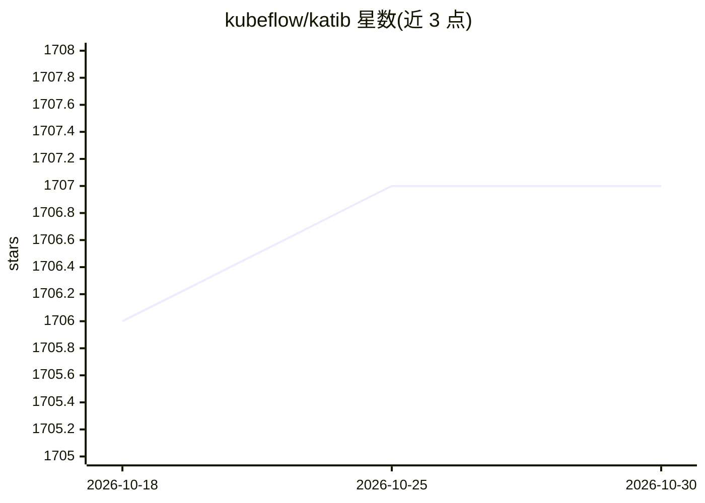

# kubeflow/katib

⭐ 1,707 · Python · Apache-2.0 · 推送 2026-10-25 · [GitHub](https://github.com/kubeflow/katib) · [官网](https://www.kubeflow.org/docs/components/katib) · 组织维护

**Kubernetes 上的 AutoML 系统：超参调优、早停与神经架构搜索**

Kubeflow 生态的 Kubernetes 原生 AutoML 项目，提供超参数调优、早停（Early Stopping）与神经架构搜索（NAS）能力。对 ML 框架不敏感，可调优任意语言编写的应用，原生支持 TensorFlow、PyTorch、XGBoost 等；训练作业可通过 Kubernetes 自定义资源运行，开箱支持 Kubeflow Training Operator、Argo Workflows、Tekton Pipelines。内置 Random、Grid、贝叶斯优化、TPE、CMA-ES、HyperBand 等搜索算法，底层可接 Goptuna、Hyperopt、Optuna、Scikit-Optimize。提供 kubectl 安装的控制面与 pip 安装的 Python SDK。

## 筛选速览

| 维度 | 判定 | 备注 |
|---|---|---|
| AI 角色 | `ai-ecosystem` | LLM/agent 周边工具 |
| 许可风险 | `permissive` | Apache-2.0 |
| 部署形态 | `library` | 以包/库形式分发 |
| 模型依赖 | — | README 未给出锁定关系 |
| 硬件要求 | — | 无带数字的原话,不猜 |
| 安装摩擦 | `low` | 无编译、无系统依赖或容器化 |
| 成熟度 | — | 结构信号不足 |

## 能力要点

- 超参调优、早停、神经架构搜索三类 AutoML 能力
- 框架无关，支持 TensorFlow/PyTorch/XGBoost 等及任意语言应用
- 支持十余种搜索算法（Random/Grid/贝叶斯/TPE/CMA-ES/HyperBand 等）
- 控制面经 kubectl 安装，另提供 Python SDK 创建调优作业

## 适用场景

- 在 Kubernetes 集群上自动调优模型超参数
- 通过 Python SDK 快速创建超参调优 Experiment
- 执行神经架构搜索与训练早停以节省资源

## 场景标签

`MLOps` · 领域:训练与推理

## 证据(README 行号)

> L13: Kubeflow Katib is a Kubernetes-native project for automated machine learning (AutoML).
> L26: with out of the box support for Kubeflow Training Operator,

## 星数曲线

2026-10-18 1,706 → 2026-10-30 1,707（+1）

---
*卡片 v1 · prompt 1.4 · 生成 2026-10-21 · 置信度 high · 依据 README sha `5082ad4ef671` · [字段定义](../../DATASET.md)*
