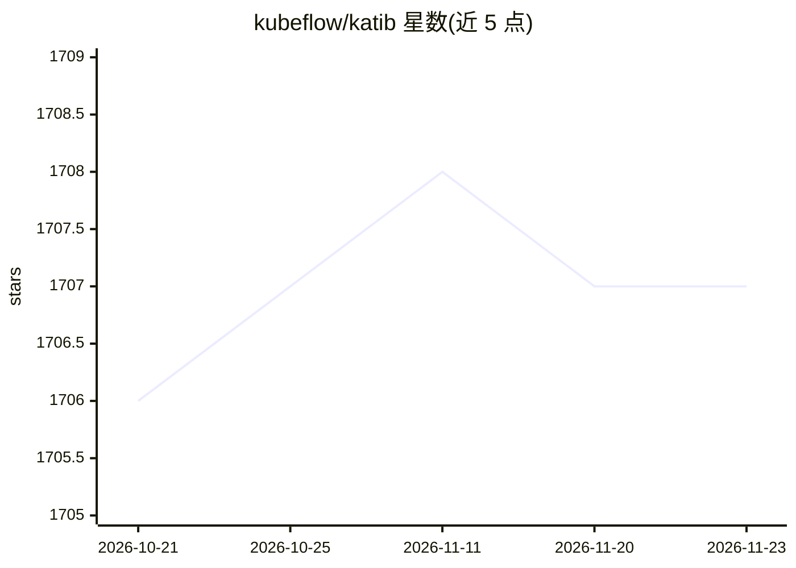

# kubeflow/katib

⭐ 1,707 · Python · Apache-2.0 · 推送 2026-11-22 · [GitHub](https://github.com/kubeflow/katib) · [官网](https://www.kubeflow.org/docs/components/katib) · 组织维护

**Kubernetes 原生 AutoML 系统：超参调优与神经架构搜索**

Kubeflow Katib 是 Kubernetes 原生的 AutoML 项目，支持超参调优、早停与神经架构搜索。它对 ML 框架不可知，可调优任意语言编写的应用，原生支持 TensorFlow、PyTorch、XGBoost 等框架，并可借助 Kubeflow Training Operator、Argo Workflows、Tekton Pipelines 等 Kubernetes Custom Resources 执行训练任务。内置随机搜索、贝叶斯优化、TPE、HyperBand、PBT 等多种搜索算法，底层对接 Goptuna、Hyperopt、Optuna 等框架。提供 Python SDK（pip 安装），控制平面通过 kubectl apply 安装。README 声明项目已弃用，用户应迁移至 Kubeflow Trainer 的 OptimizationJob API。

## 筛选速览

| 维度 | 判定 | 备注 |
|---|---|---|
| AI 角色 | `ai-ecosystem` | LLM/agent 周边工具 |
| 许可风险 | `permissive` | Apache-2.0 |
| 部署形态 | `library` | 以包/库形式分发 |
| 模型依赖 | — | README 未给出锁定关系 |
| 硬件要求 | — | 无带数字的原话,不猜 |
| 安装摩擦 | `low` | 无编译、无系统依赖或容器化 |
| 成熟度 | — | 结构信号不足 |

## 能力要点

- 支持超参调优、早停与神经架构搜索
- 内置随机搜索、贝叶斯优化、TPE、HyperBand、PBT 等多种算法
- 框架不可知：原生支持 TensorFlow/PyTorch/XGBoost，可调优任意语言应用
- 提供 Python SDK 与 kubectl 安装路径

## 适用场景

- 在 Kubernetes 集群上运行分布式超参调优实验
- 对任意 ML 框架的训练作业做自动超参搜索
- 执行神经架构搜索任务

## 场景标签

`MLOps` · 领域:训练与推理

## 证据(README 行号)

> L27: Kubeflow Katib is a Kubernetes-native project for automated machine learning (AutoML).
> L29: Hyperparameter Tuning,
> L33: Katib is the project which is agnostic to machine learning (ML) frameworks.

## 星数曲线

2026-10-21 1,706 → 2026-11-23 1,707（+1）

---
*卡片 v1 · prompt 1.4 · 生成 2026-11-23 · 置信度 high · 依据 README sha `fe1a85bc0512` · [字段定义](../../DATASET.md)*
