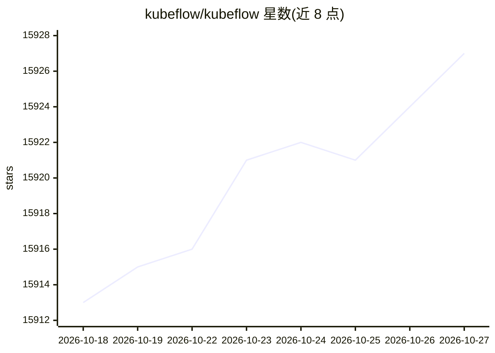

# kubeflow/kubeflow

⭐ 15,927 · Apache-2.0 · 推送 2026-09-30 · [GitHub](https://github.com/kubeflow/kubeflow) · [官网](https://www.kubeflow.org/) · 组织维护

**面向 AI 从业者与管理员的云原生 AI 平台**

Kubeflow 是由模块化开源项目组成的 Kubernetes 原生技术栈，面向 AI 从业者、平台管理员与决策者，支持数据、AI/ML 与 HPC 工作负载。项目由社区工作组维护，覆盖 AI 生命周期各环节，强调可移植（本地/本地机房/云同一套代码）与可扩展（超大规模训练与高吞吐 AI agent）。本仓库主要作为各子项目的入口与共享元数据，开发在子项目仓库进行；README 未给出安装与运行步骤。

## 筛选速览

| 维度 | 判定 | 备注 |
|---|---|---|
| AI 角色 | `ai-ecosystem` | LLM/agent 周边工具 |
| 许可风险 | `permissive` | Apache-2.0 |
| 部署形态 | `None` |  |
| 模型依赖 | — | README 未给出锁定关系 |
| 硬件要求 | — | 无带数字的原话,不猜 |
| 安装摩擦 | `low` | 无编译、无系统依赖或容器化 |
| 成熟度 | — | 结构信号不足 |

## 动量与使用信号

- 维护:`active` — 距上次 push 17.4 天,年发版 1,287 位贡献者
- 涨星:近 1 天 **+3**(自 20261016 起算)

## 能力要点

- 由模块化开源项目组成，可按需组合跨 AI 生命周期使用
- 同一代码可在本地笔记本、本地机房或任意云上运行
- 社区主导，由多个工作组与委员会维护
- 本仓库作为子项目入口与项目元数据承载

## 适用场景

- 在 Kubernetes 上运行机器学习训练工作负载
- 在本地、机房或云间迁移同一套 AI 工作负载
- 组建团队级数据与 AI 平台时按模块选型子项目

## 场景标签

`MLOps` `模型训练` · 领域:训练与推理

## 证据(README 行号)

> L7: Kubeflow is _the_ Cloud Native AI platform.
> L9: Kubeflow is composed of modular, open source projects that form the Kubernetes-native stack
> L43: This repository serves primarily as a gateway to Kubeflow subprojects and shared project metadata.

## 星数曲线

2026-10-18 15,913 → 2026-10-27 15,927（+14）

---
*卡片 v1 · prompt 1.4 · 生成 2026-10-18 · 置信度 mid · 依据 README sha `1cc74e76e05e` · [字段定义](../../DATASET.md)*
