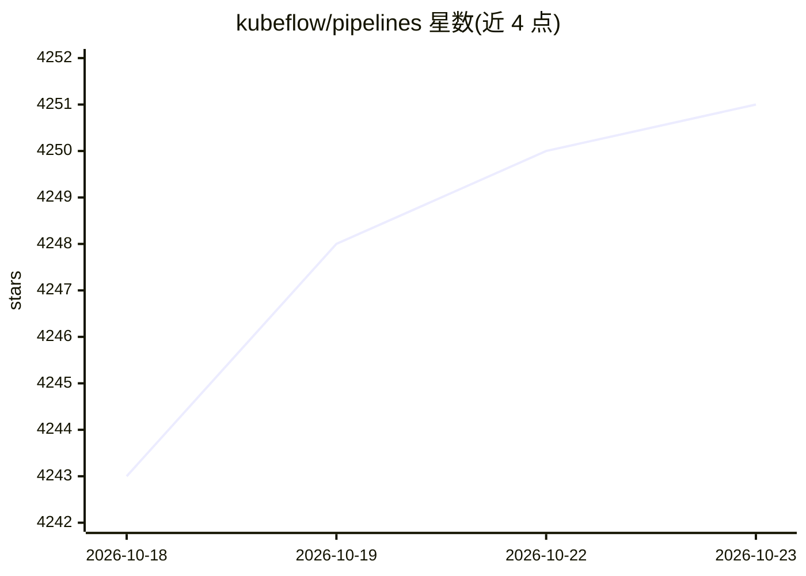

# kubeflow/pipelines

⭐ 4,251 · Go · Apache-2.0 · 推送 2026-10-22 · [GitHub](https://github.com/kubeflow/pipelines) · [官网](https://www.kubeflow.org/docs/components/pipelines/) · 组织维护

**Kubernetes 上的端到端 ML 工作流编排服务**

Kubeflow 生态中的流水线组件：用 Pipelines SDK 构建可复用的端到端 ML 工作流，在 Kubernetes 上编排、实验与管理。目标包括端到端编排、简化实验试错、组件与流水线复用。可随 Kubeflow 平台安装或作为独立服务部署；流水线执行使用 Argo Emissary executor（不依赖 K8s 容器运行时）。依赖 Argo Workflows（KFP 3.0 支持 4.x）与 MySQL v8，提供 Python SDK、API 文档与源码构建指南。

## 筛选速览

| 维度 | 判定 | 备注 |
|---|---|---|
| AI 角色 | `ai-ecosystem` | LLM/agent 周边工具 |
| 许可风险 | `permissive` | Apache-2.0 |
| 部署形态 | `None` |  |
| 模型依赖 | — | README 未给出锁定关系 |
| 硬件要求 | — | 无带数字的原话,不猜 |
| 安装摩擦 | `low` | 无编译、无系统依赖或容器化 |
| 成熟度 | — | 结构信号不足 |

## 能力要点

- 基于 SDK 的可复用端到端 ML 流水线构建
- Kubernetes 原生编排，Argo Emissary executor 执行
- 可随 Kubeflow 平台安装或独立部署
- 提供 Python SDK 与 API 文档

## 适用场景

- 在 Kubernetes 上编排机器学习训练与部署流程
- 管理多次实验与试错并复用流水线组件
- 构建从数据处理到模型服务的端到端 MLOps 流程

## 场景标签

`MLOps` · 领域:训练与推理

## 证据(README 行号)

> L11: Kubeflow is a machine learning (ML) toolkit that is dedicated to making deployments of ML workflows on Kubernetes s
> L13: **Kubeflow pipelines** are reusable end-to-end ML workflows built using the Kubeflow Pipelines SDK.

## 星数曲线

2026-10-18 4,243 → 2026-10-23 4,251（+8）

---
*卡片 v1 · prompt 1.4 · 生成 2026-10-21 · 置信度 high · 依据 README sha `214ef5a7538b` · [字段定义](../../DATASET.md)*
