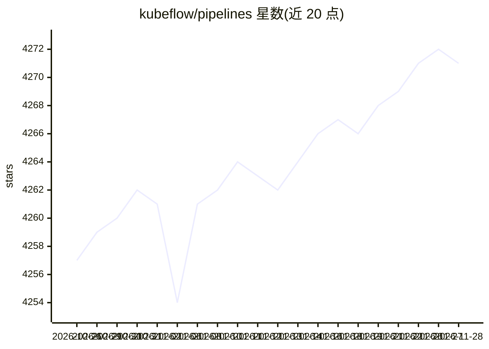

# kubeflow/pipelines

⭐ 4,271 · Python · Apache-2.0 · 推送 2026-11-25 · [GitHub](https://github.com/kubeflow/pipelines) · [官网](https://www.kubeflow.org/docs/components/pipelines/) · 组织维护

**在 Kubernetes 上编排端到端机器学习工作流的流水线服务**

Kubeflow Pipelines 是 Kubeflow 的 ML 工作流编排组件，用户通过 Python SDK 构建可复用的端到端 ML 流水线，服务提供端到端编排、实验管理与组件复用三类目标能力。流水线执行使用独立于 Kubernetes 容器运行时的 Argo Emissary executor，可随 Kubeflow 平台安装或作为独立服务部署，依赖 Argo Workflows v4.x 与 MySQL v8。README 另提供 SDK/API 文档入口、贡献指南与可选的 just 命令行封装。

## 筛选速览

| 维度 | 判定 | 备注 |
|---|---|---|
| AI 角色 | `ai-ecosystem` | LLM/agent 周边工具 |
| 许可风险 | `permissive` | Apache-2.0 |
| 部署形态 | `None` |  |
| 模型依赖 | — | README 未给出锁定关系 |
| 硬件要求 | — | 无带数字的原话,不猜 |
| 安装摩擦 | `low` | 无编译、无系统依赖或容器化 |
| 成熟度 | — | 结构信号不足 |

## 能力要点

- 通过 Python SDK 构建可复用的端到端 ML 工作流
- 支持随 Kubeflow 平台安装或独立服务部署
- 使用 Argo Emissary executor，独立于容器运行时
- 维护 Argo Workflows/MySQL 依赖兼容矩阵

## 适用场景

- 在 Kubernetes 集群上编排训练与部署工作流
- 管理和对比多个实验与 trial
- 以组件复用方式拼装端到端 ML 解决方案

## 场景标签

`MLOps` · 领域:训练与推理

## 证据(README 行号)

> L11: Kubeflow is a machine learning (ML) toolkit that is dedicated to making deployments of ML workflows on Kubernetes s
> L13: **Kubeflow pipelines** are reusable end-to-end ML workflows built using the Kubeflow Pipelines SDK.
> L17: * End to end orchestration: enabling and simplifying the orchestration of end to end machine learning pipelines

## 星数曲线

2026-10-26 4,257 → 2026-11-28 4,271（+14）

---
*卡片 v1 · prompt 1.4 · 生成 2026-11-23 · 置信度 high · 依据 README sha `fba8126d511b` · [字段定义](../../DATASET.md)*
