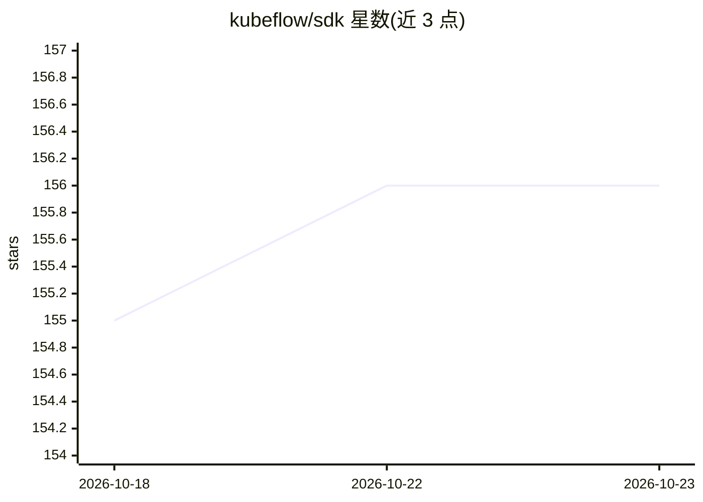

# kubeflow/sdk

⭐ 156 · Python · Apache-2.0 · 推送 2026-10-22 · [GitHub](https://github.com/kubeflow/sdk) · [官网](https://sdk.kubeflow.org/en/latest/) · 组织维护

**在 Kubernetes 上运行 AI 工作负载的统一 Python SDK**

Kubeflow 生态的统一 Python API 集合，用一致的 Pythonic 接口覆盖模型训练与微调（Trainer）、超参数优化（Katib）、模型注册管理（Model Registry）、Spark 数据处理与 Pipelines 工作流，用户无需学习 Kubernetes 细节。训练客户端支持三种后端：KubernetesBackend（生产）、ContainerBackend（Docker/Podman 本地隔离）、LocalProcessBackend（子进程快速原型），同一 API 可从本地笔记本扩展到数千 GPU 集群。以 pip 包分发，部分功能需附加安装项（spark/hub/pipelines）。Feast 特征存储为计划中支持。

## 筛选速览

| 维度 | 判定 | 备注 |
|---|---|---|
| AI 角色 | `ai-ecosystem` | LLM/agent 周边工具 |
| 许可风险 | `permissive` | Apache-2.0 |
| 部署形态 | `library` | 以包/库形式分发 |
| 模型依赖 | — | README 未给出锁定关系 |
| 硬件要求 | — | 无带数字的原话,不猜 |
| 安装摩擦 | `low` | 无编译、无系统依赖或容器化 |
| 成熟度 | — | 结构信号不足 |

## 能力要点

- 统一 Python API 覆盖 Trainer/Katib/Model Registry/Spark/Pipelines 五个项目
- 同一 API 支持从本地开发到数千 GPU 生产集群
- 三种训练后端：Kubernetes / 容器隔离 / 本地子进程
- LLM Fine-Tuning with BuiltinTrainer 演示

## 适用场景

- 在 Kubernetes 上运行 PyTorch 分布式训练作业
- 用统一 SDK 做超参数优化与模型版本管理
- 本地无集群环境下原型开发训练代码，再迁到生产集群
- 用 Spark 客户端做数据处理与特征工程

## 场景标签

`微调` `MLOps` `模型训练` · 领域:训练与推理

## 证据(README 行号)

> L21: The Kubeflow SDK is a set of unified Pythonic APIs that let you run any AI workload at any scale –
> L179: |**Kubeflow Trainer**|✅ **Available**|v2.0.0+|Train and fine-tune AI models with various frameworks|

## 星数曲线

2026-10-18 155 → 2026-10-23 156（+1）

---
*卡片 v1 · prompt 1.4 · 生成 2026-10-22 · 置信度 high · 依据 README sha `13b39491a4be` · [字段定义](../../DATASET.md)*
