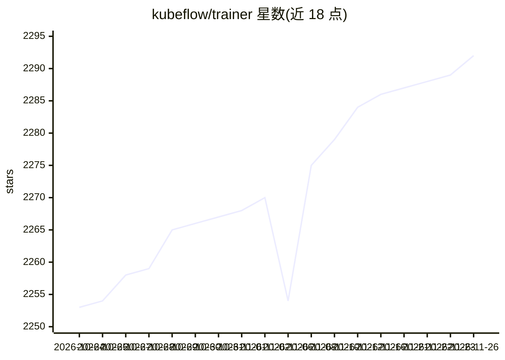

# kubeflow/trainer

⭐ 2,292 · Go · Apache-2.0 · 推送 2026-11-25 · [GitHub](https://github.com/kubeflow/trainer) · [官网](https://trainer.kubeflow.org/en/latest/) · 组织维护

**在 Kubernetes 上进行分布式训练与 LLM 微调的平台**

Kubeflow Trainer 是一个 Kubernetes 原生的分布式 AI 平台，提供 LLM 微调、超参数优化与多框架模型训练能力，支持的框架包括 PyTorch、MLX、HuggingFace、DeepSpeed、Megatron-LM、JAX、XGBoost 等。通过 MPI 编排多节点多 GPU 分布式作业，集成 Kueue、Volcano 等调度组件，并提供分布式数据缓存以零拷贝方式向 GPU 节点流式传输数据。AI 从业者可通过 Python SDK 使用 TrainJob 与 Runtimes API。项目处于 alpha 状态，API 可能变更。

## 筛选速览

| 维度 | 判定 | 备注 |
|---|---|---|
| AI 角色 | `ai-ecosystem` | LLM/agent 周边工具 |
| 许可风险 | `permissive` | Apache-2.0 |
| 部署形态 | `library` | 以包/库形式分发 |
| 模型依赖 | — | README 未给出锁定关系 |
| 硬件要求 | — | 无带数字的原话,不猜 |
| 安装摩擦 | `low` | 无编译、无系统依赖或容器化 |
| 成熟度 | `idea` | |

## 能力要点

- 支持 PyTorch、MLX、HuggingFace、DeepSpeed、Megatron-LM、JAX、XGBoost 等多框架训练运行时
- MPI 编排多节点多 GPU 分布式作业，面向 HPC 集群
- 分布式数据缓存以零拷贝方式向 GPU 节点流式传输数据
- 提供 Python SDK（CustomTrainer/BuiltinTrainer）与 TrainJob、Runtimes API

## 适用场景

- 在 Kubernetes 集群上微调大语言模型
- 跨多节点多 GPU 运行分布式训练作业
- 在混合 Kubernetes 与 Slurm 集群上调度 AI 工作负载
- 进行大规模训练数据的分布式缓存与传输

## 场景标签

`微调` `模型训练` `MLOps` · 领域:训练与推理

## 证据(README 行号)

> L46: Kubeflow Trainer is a Kubernetes-native distributed AI platform for scalable large language model
> L69: With the Kubeflow Python SDK, AI practitioners can effortlessly

## 星数曲线

2026-10-24 2,253 → 2026-11-26 2,292（+39）

---
*卡片 v1 · prompt 1.4 · 生成 2026-11-24 · 置信度 high · 依据 README sha `d71dbf65c5db` · [字段定义](../../DATASET.md)*
