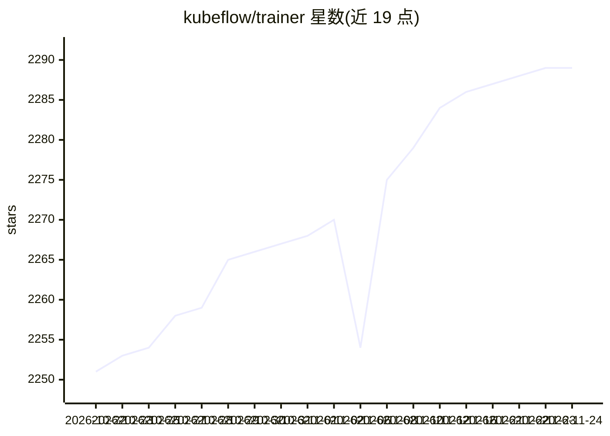

# kubeflow/trainer

⭐ 2,289 · Go · Apache-2.0 · 推送 2026-11-22 · [GitHub](https://github.com/kubeflow/trainer) · [官网](https://trainer.kubeflow.org/en/latest/) · 组织维护

**Kubernetes 上的分布式模型训练与 LLM 微调平台**

Kubernetes 原生的分布式 AI 训练平台，面向 LLM 微调、超参数优化和跨框架模型训练，支持 PyTorch、HuggingFace、DeepSpeed、JAX、XGBoost 等运行时。通过 MPI 编排多节点、多 GPU 分布式作业，集成 Kueue/KAI Scheduler 调度，提供零拷贝分布式数据缓存直传 GPU。AI 从业者通过 Python SDK 使用 TrainJob 与 Runtimes API 进行开发与微调。当前项目处于 alpha 状态，API 可能变更。

## 筛选速览

| 维度 | 判定 | 备注 |
|---|---|---|
| AI 角色 | `ai-ecosystem` | LLM/agent 周边工具 |
| 许可风险 | `permissive` | Apache-2.0 |
| 部署形态 | `library` | 以包/库形式分发 |
| 模型依赖 | — | README 未给出锁定关系 |
| 硬件要求 | — | 无带数字的原话,不猜 |
| 安装摩擦 | `low` | 无编译、无系统依赖或容器化 |
| 成熟度 | `idea` | |

## 能力要点

- 支持 PyTorch、HuggingFace、DeepSpeed、Megatron-LM、JAX、XGBoost 等多框架训练运行时
- MPI 编排多节点多 GPU 分布式作业，面向 HPC 集群
- 分布式数据缓存零拷贝流式传输到 GPU 节点
- Kubeflow Python SDK 提供 TrainJob 与 Runtimes API

## 适用场景

- 在 Kubernetes 集群上进行 LLM 微调与超参数优化
- 多节点多 GPU 的大规模分布式训练作业编排
- 混合 Kubernetes 与 Slurm 集群的 HPC AI 工作负载调度

## 场景标签

`微调` `模型训练` · 领域:训练与推理

## 证据(README 行号)

> L46: Kubeflow Trainer is a Kubernetes-native distributed AI platform for scalable large language model
> L47: (LLM) fine-tuning, hyperparameter optimization, and training of AI models across a wide range of frameworks,
> L69: With the Kubeflow Python SDK, AI practitioners can effortlessly
> L70: develop and fine-tune LLMs while leveraging the Kubeflow Trainer APIs: TrainJob and Runtimes.

## 星数曲线

2026-10-22 2,251 → 2026-11-24 2,289（+38）

---
*卡片 v1 · prompt 1.4 · 生成 2026-11-23 · 置信度 high · 依据 README sha `7d7dbad7d9b7` · [字段定义](../../DATASET.md)*
