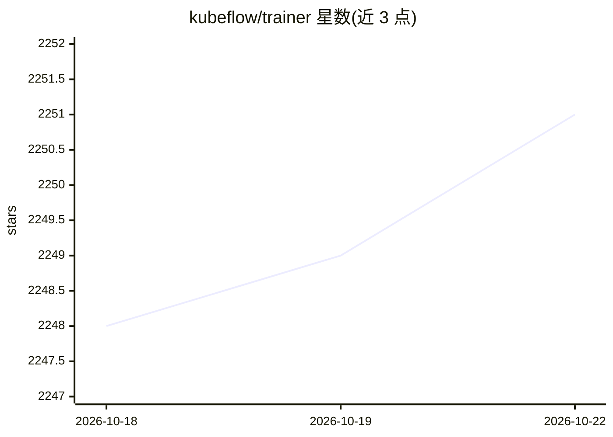

# kubeflow/trainer

⭐ 2,253 · Go · Apache-2.0 · 推送 2026-10-22 · [GitHub](https://github.com/kubeflow/trainer) · [官网](https://trainer.kubeflow.org/en/latest/) · 组织维护

**Kubernetes 原生的分布式模型训练与 LLM 微调平台**

Kubeflow 生态下的 Kubernetes 原生分布式训练组件：通过 TrainJob 与 Runtime API 编排多节点、多 GPU 训练任务，支持 PyTorch、MLX、HuggingFace、DeepSpeed、Megatron-LM、JAX、XGBoost 等框架，并将 MPI 引入 Kubernetes 以运行 HPC 集群作业。集成 Kueue 拓扑感知调度、Slurm Bridge 混合调度与分布式数据缓存（零拷贝直传 GPU 节点）。提供 Python SDK 供 AI 从业者开发与微调 LLM。项目当前处于 alpha 状态，API 可能变更；安装指引跳转官方文档。

## 筛选速览

| 维度 | 判定 | 备注 |
|---|---|---|
| AI 角色 | `ai-ecosystem` | LLM/agent 周边工具 |
| 许可风险 | `permissive` | Apache-2.0 |
| 部署形态 | `None` |  |
| 模型依赖 | — | README 未给出锁定关系 |
| 硬件要求 | — | 无带数字的原话,不猜 |
| 安装摩擦 | `low` | 无编译、无系统依赖或容器化 |
| 成熟度 | `idea` | |

## 能力要点

- TrainJob/Runtime API 编排多节点多 GPU 分布式训练
- 支持 PyTorch、HuggingFace、DeepSpeed、Megatron-LM、JAX、XGBoost 等框架
- MPI 上 Kubernetes，支持 HPC 集群与 Slurm 混合调度
- 分布式数据缓存：大规模数据零拷贝直传 GPU 节点

## 适用场景

- 在 Kubernetes 集群上运行 LLM 微调与大规模分布式训练
- 跨多节点多 GPU 的 HPC/MPI 训练作业编排
- 通过 Python SDK 开发并提交训练任务

## 场景标签

`微调` `模型训练` · 领域:训练与推理

## 证据(README 行号)

> L41: Kubeflow Trainer is a Kubernetes-native distributed AI platform for scalable large language model
> L64: With the Kubeflow Python SDK, AI practitioners can effortlessly

## 星数曲线

2026-10-18 2,248 → 2026-10-22 2,251（+3）

---
*卡片 v1 · prompt 1.4 · 生成 2026-10-21 · 置信度 high · 依据 README sha `231b2687e7e6` · [字段定义](../../DATASET.md)*
