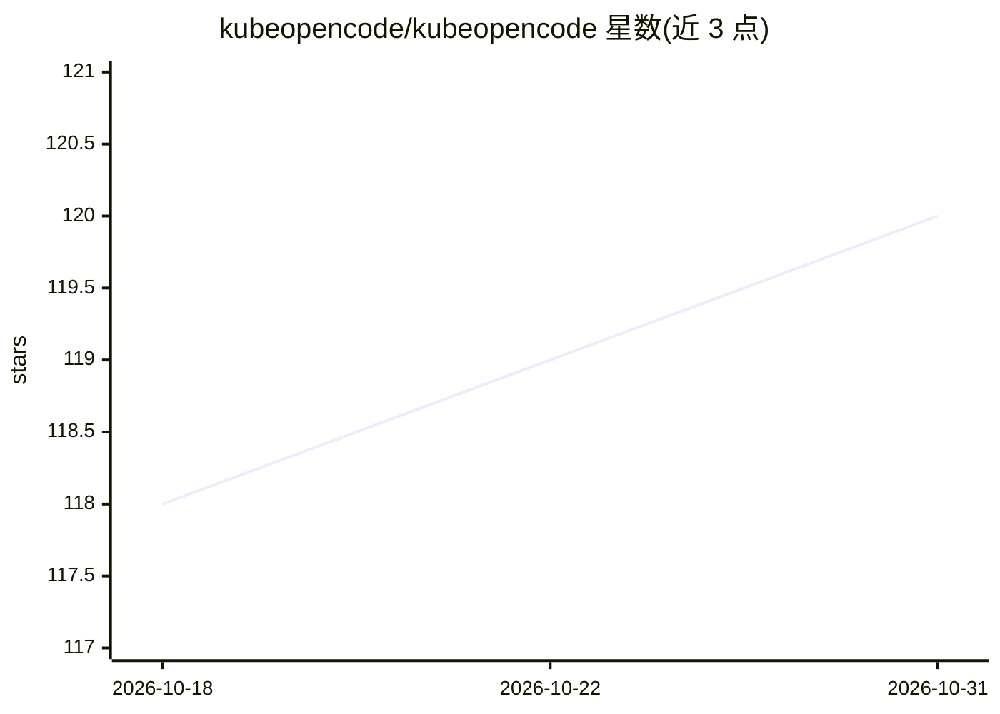

# kubeopencode/kubeopencode

⭐ 120 · Go · MIT · 推送 2026-10-30 · [GitHub](https://github.com/kubeopencode/kubeopencode) · [官网](https://kubeopencode.github.io/kubeopencode/) · 组织维护

**在 Kubernetes 上运行 OpenCode AI agent 的企业级平台**

基于 OpenCode AI agent 构建的 Kubernetes 原生 agent 平台，面向团队与企业：通过 CRD（Agent 资源）声明式创建 agent，由 Helm 部署到集群，提供共享 agent 配置、治理、规模化与企业基础设施集成。附带 CLI 工具 kubeoc（go install 安装），可列出 agent 并从终端 attach 到运行中的 agent 会话。项目独立于 OpenCode 团队，MIT 许可。

## 筛选速览

| 维度 | 判定 | 备注 |
|---|---|---|
| AI 角色 | `ai-ecosystem` | LLM/agent 周边工具 |
| 许可风险 | `permissive` | MIT |
| 部署形态 | `library` | 以包/库形式分发 |
| 模型依赖 | — | README 未给出锁定关系 |
| 硬件要求 | — | 无带数字的原话,不猜 |
| 安装摩擦 | `low` | 无编译、无系统依赖或容器化 |
| 成熟度 | — | 结构信号不足 |

## 能力要点

- 通过 CRD 声明式定义并运行 agent
- Helm Chart 部署到 Kubernetes 集群
- kubeoc CLI 支持列出 agent 并 attach 到活跃会话
- 面向团队/企业的共享配置与治理能力

## 适用场景

- 团队在 Kubernetes 集群中统一部署和管理 AI agent
- 从终端 attach 到集群中运行中的 agent 会话
- 企业以声明式方式治理多个 agent 实例

## 场景标签

`编码 Agent` · 领域:编码与开发

## 证据(README 行号)

> L3:  Kubernetes-native Agent Platform for Teams and Enterprise
> L8: > **Note**: KubeOpenCode builds on the excellent OpenCode AI agent. OpenCode is great for individual developers — Ku

## 星数曲线

2026-10-18 118 → 2026-10-31 120（+2）

---
*卡片 v1 · prompt 1.4 · 生成 2026-10-23 · 置信度 high · 依据 README sha `84fdcb59f59d` · [字段定义](../../DATASET.md)*
