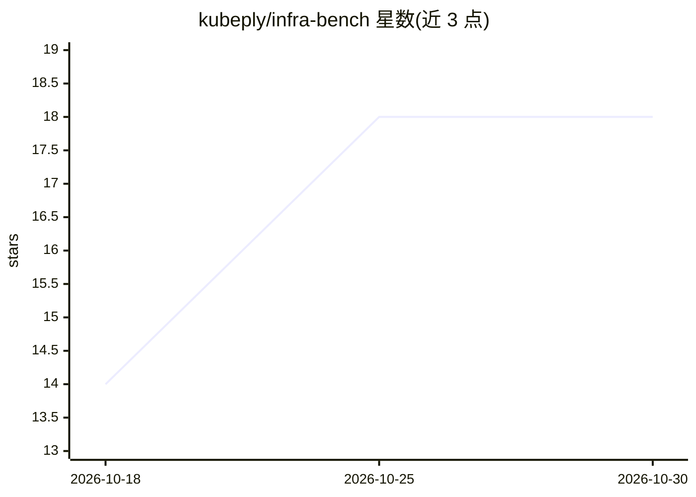

# kubeply/infra-bench

⭐ 18 · Shell · Apache-2.0 · 推送 2026-06-27 · [GitHub](https://github.com/kubeply/infra-bench) · [官网](https://kubeply.com/benchmark) · 组织维护

**评估 AI agent 基础设施能力的开放基准数据集（Kubernetes 起步）**

由 Kubeply 维护的开放基准：提供真实的基础设施运维任务用于评估 AI agent。首个数据集 kubeply/kubernetes-core 含 71 个任务（易 22/中 27/难 22），另登记 terraform-core（空）与 observability-core（未开始）。任务兼容 Harbor 框架，通过 uvx 命令运行；重复本地运行需先配置 k3s registry 认证以便临时集群拉取 Docker Hub 镜像；还提供对比原生 kubectl agent 与 kply 工作流的成对任务。Apache 2.0 许可，附学术引用条目。

## 筛选速览

| 维度 | 判定 | 备注 |
|---|---|---|
| AI 角色 | `ai-knowledge` | 知识聚合/清单类 |
| 许可风险 | `permissive` | Apache-2.0 |
| 部署形态 | `None` |  |
| 模型依赖 | — | README 未给出锁定关系 |
| 硬件要求 | — | 无带数字的原话,不猜 |
| 安装摩擦 | `low` | 无编译、无系统依赖或容器化 |
| 成熟度 | — | 结构信号不足 |

## 能力要点

- kubernetes-core 数据集含 71 个三档难度任务
- 任务兼容 Harbor，可经 uvx 运行
- 提供 kubectl 与 kply 工作流的成对对比任务

## 适用场景

- 用真实 Kubernetes 运维任务评估 AI agent 能力
- 对比不同 agent（原生 kubectl vs 结构化工作流）的行为表现
- 为学术论文引用基础设施 agent 基准

## 场景标签

`模型评测` · 领域:评测与运维

## 证据(README 行号)

> L3: `infra-bench` is an open benchmark of realistic infrastructure tasks for evaluating AI agents.
> L9: |`kubeply/kubernetes-core`|22|27|22|🛠️ Working|

## 星数曲线

2026-10-18 14 → 2026-10-30 18（+4）

---
*卡片 v1 · prompt 1.4 · 生成 2026-10-29 · 置信度 high · 依据 README sha `16313545f094` · [字段定义](../../DATASET.md)*
