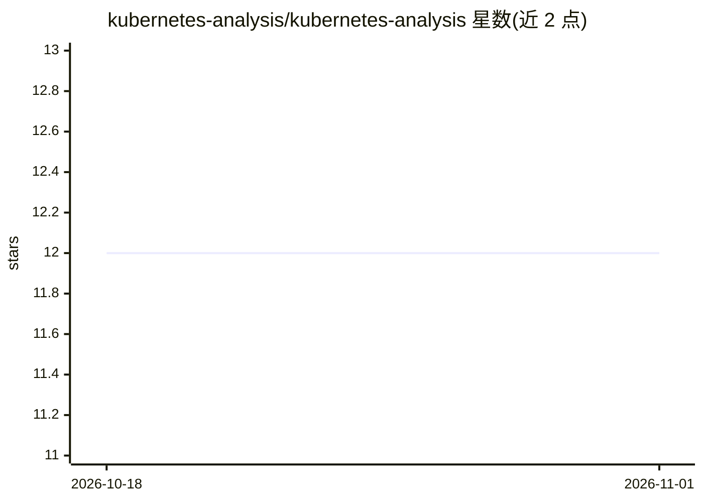

# kubernetes-analysis/kubernetes-analysis

⭐ 12 · Python · MIT · 推送 2025-12-05 · [GitHub](https://github.com/kubernetes-analysis/kubernetes-analysis) · 个人维护

**用机器学习持续分析 Kubernetes 仓库 issue 与 PR 的项目**

该项目对 Kubernetes GitHub 仓库的全部 issue 与 Pull Request 进行持续数据分析，分析过程由机器学习驱动，并配套一篇博客文章说明项目目的。README 仅给出项目定位与联系方式，未提供安装、运行或使用说明，也未列出所用模型或算法细节。面向关注 Kubernetes 社区运作与 issue/PR 趋势的开发者与研究者。

## 筛选速览

| 维度 | 判定 | 备注 |
|---|---|---|
| AI 角色 | `ai-native` | 本体是模型或模型工具 |
| 许可风险 | `permissive` | MIT |
| 部署形态 | `None` |  |
| 模型依赖 | — | README 未给出锁定关系 |
| 硬件要求 | — | 无带数字的原话,不猜 |
| 安装摩擦 | `low` | 无编译、无系统依赖或容器化 |
| 成熟度 | — | 结构信号不足 |

## 能力要点

- 对 Kubernetes 仓库全部 issue 与 PR 做持续数据分析
- 分析由机器学习驱动

## 适用场景

- 了解 Kubernetes issue 与 PR 的机器学习分析结果
- 参考其分析思路用于其他大型开源仓库的社区数据研究

## 场景标签

`数据分析` · 领域:效率与自动化

## 证据(README 行号)

> L3: ### Kubernetes issue and pull request analysis powered by machine learning
> L5: This project aims to provide continuous data analysis of all GitHub issues and
> L6: Pull Requests (PRs) in the [Kubernetes][0] repository.

## 星数曲线

2026-10-18 12 → 2026-11-01 12（+0）

---
*卡片 v1 · prompt 1.4 · 生成 2026-11-01 · 置信度 low · 依据 README sha `97b91a5cf7fe` · [字段定义](../../DATASET.md)*
