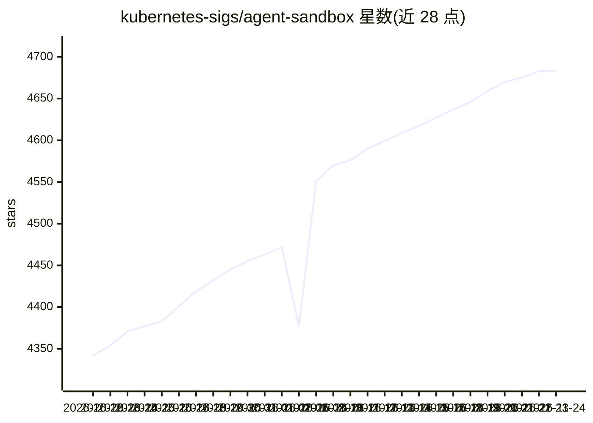

# kubernetes-sigs/agent-sandbox

⭐ 4,683 · Go · Apache-2.0 · 推送 2026-11-21 · [GitHub](https://github.com/kubernetes-sigs/agent-sandbox) · [官网](https://agent-sandbox.sigs.k8s.io) · 组织维护

**Kubernetes 上的沙箱编排器：为 AI agent 运行时提供隔离有状态工作负载**

由 Kubernetes SIG Apps 下的社区开发的 Sandbox CRD 与控制器，为需要长期运行、有状态、单实例且身份稳定的容器工作负载提供声明式标准化 API，覆盖创建、定时删除、暂停与恢复的生命周期管理。扩展模块提供 SandboxTemplate、SandboxClaim 与 SandboxWarmPool（预热池以缩短启动时间）。容器隔离委托给 gVisor/Kata 等 Sandbox Runtimes（经 RuntimeClass 配置）。要求 Kubernetes 1.25+（推荐 1.29+），通过 kubectl apply 清单或 Helm 安装，并附 Go 与 Python SDK 及可选的 HTTP 反向代理 Sandbox Router。

## 筛选速览

| 维度 | 判定 | 备注 |
|---|---|---|
| AI 角色 | `ai-ecosystem` | LLM/agent 周边工具 |
| 许可风险 | `permissive` | Apache-2.0 |
| 部署形态 | `library` | 以包/库形式分发 |
| 模型依赖 | — | README 未给出锁定关系 |
| 硬件要求 | — | 无带数字的原话,不猜 |
| 安装摩擦 | `low` | 无编译、无系统依赖或容器化 |
| 成熟度 | — | 结构信号不足 |

## 能力要点

- Sandbox CRD 提供稳定身份、持久存储与生命周期管理（创建/暂停/恢复/定时删除）
- SandboxWarmPool 预热池快速分配沙箱，降低启动等待
- 容器隔离委托给 gVisor、Kata Containers 等 RuntimeClass 运行时
- 提供 Go SDK、Python SDK（pip install k8s-agent-sandbox）与可选 Sandbox Router 反向代理

## 适用场景

- 为 LLM 生成的不可信代码执行提供隔离运行环境
- 为强化学习训练与评测循环（如 SWE-bench、Ray/RLlib）提供高吞吐隔离沙箱
- 为开发者提供隔离、持久、可网络访问的云开发环境
- 托管需要稳定身份的单实例有状态服务（如构建代理、小型数据库）

## 场景标签

 · 领域:云原生基础设施/AI Agent 运行时编排

## 证据(README 行号)

> L12: This project is developing a `Sandbox` Custom Resource Definition (CRD) and controller for Kubernetes, under the um
> L178: * **AI Agent Runtimes:** Isolated environments for executing untrusted, LLM-generated code.
> L15: > **Scope:** Agent Sandbox is a *sandbox orchestrator*. It delegates low-level container isolation to secure "Sandb

## 星数曲线

2026-10-22 4,342 → 2026-11-24 4,683（+341）

---
*卡片 v1 · prompt 1.4 · 生成 2026-11-23 · 置信度 high · 依据 README sha `a90650945e0c` · [字段定义](../../DATASET.md)*
