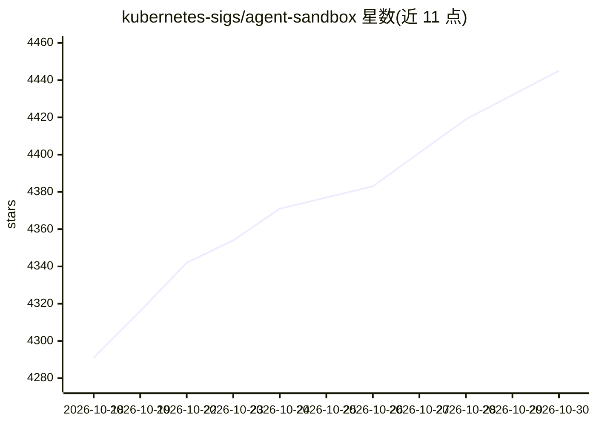

# kubernetes-sigs/agent-sandbox

⭐ 4,445 · Go · Apache-2.0 · 推送 2026-10-29 · [GitHub](https://github.com/kubernetes-sigs/agent-sandbox) · [官网](https://agent-sandbox.sigs.k8s.io) · 组织维护

**Kubernetes 沙箱编排器：管理隔离的有状态单例工作负载**

Kubernetes SIG Apps 下的项目，提供 Sandbox CRD 与控制器，以声明式 API 管理具有稳定身份、持久存储的单容器沙箱，支持创建、定时删除、暂停/恢复等生命周期操作。底层容器隔离委托给 gVisor、Kata Containers 等运行时（经 RuntimeClass 配置）。扩展模块包含 SandboxTemplate、SandboxClaim 与 SandboxWarmPool（预热池降低分配延迟）。面向 AI agent 运行时、强化学习训练/评测、云端开发环境与 Jupyter 会话等场景，提供 Go 与 Python SDK 及可选的 Sandbox Router 反向代理。

## 筛选速览

| 维度 | 判定 | 备注 |
|---|---|---|
| AI 角色 | `ai-ecosystem` | LLM/agent 周边工具 |
| 许可风险 | `permissive` | Apache-2.0 |
| 部署形态 | `library` | 以包/库形式分发 |
| 模型依赖 | — | README 未给出锁定关系 |
| 硬件要求 | — | 无带数字的原话,不猜 |
| 安装摩擦 | `low` | 无编译、无系统依赖或容器化 |
| 成熟度 | — | 结构信号不足 |

## 能力要点

- Sandbox CRD：稳定主机名/网络身份、可持久存储的生命周期管理
- SandboxWarmPool 预热池快速分配沙箱
- 通过 RuntimeClass 委托 gVisor/Kata Containers 做内核与网络隔离
- 提供 Go SDK 与 Python SDK（pip 包 k8s-agent-sandbox）

## 适用场景

- 为执行 LLM 生成的不受信代码提供隔离环境
- RL 训练与评测循环（SWE-bench、R2E-Gym、Ray/RLlib）的低延迟沙箱分配
- 搭建持久化的云端开发环境或 Jupyter 单容器会话

## 场景标签

 · 领域:云原生基础设施/AI agent 运行环境

## 证据(README 行号)

> L10: **agent-sandbox enables easy management of isolated, stateful, singleton workloads, ideal for use cases like AI age
> L170: * **AI Agent Runtimes:** Isolated environments for executing untrusted, LLM-generated code.
> L171: * **Reinforcement Learning (RL) & Evaluation:** High-throughput, isolated execution sandboxes for training and eva

## 星数曲线

2026-10-18 4,291 → 2026-10-30 4,445（+154）

---
*卡片 v1 · prompt 1.4 · 生成 2026-10-20 · 置信度 high · 依据 README sha `0ff0aa9fe37b` · [字段定义](../../DATASET.md)*
