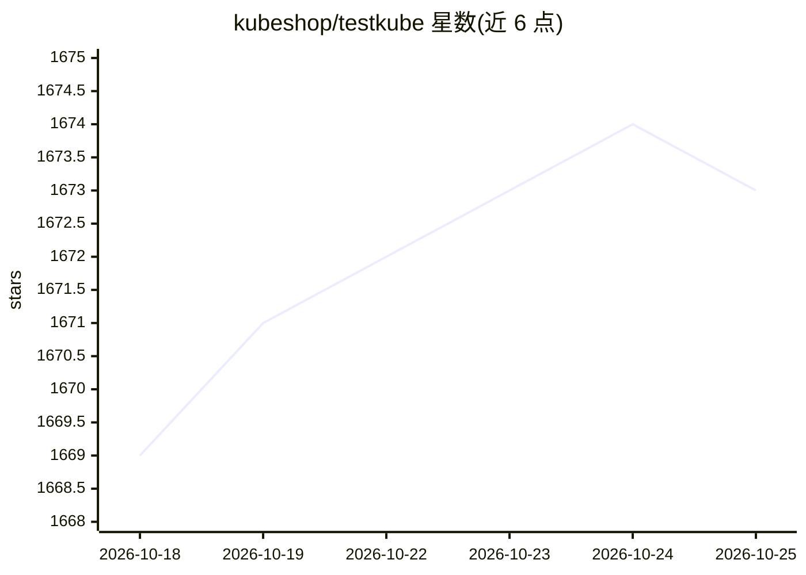

# kubeshop/testkube

⭐ 1,673 · Go · NOASSERTION · 推送 2026-10-25 · [GitHub](https://github.com/kubeshop/testkube) · [官网](https://testkube.io) · 组织维护

**面向工程团队的 Kubernetes 开源测试平台**

Testkube 在 Kubernetes 上提供统一的自动化测试平台：定义、运行与分析 API、E2E、性能、安全、基础设施等任意测试与脚本，可手动、定时、从 CI/CD/GitOps、Kubernetes 事件、REST API 或 MCP 触发，聚合测试结果、产物、日志与资源指标。通过 Webhooks、REST API 与 MCP Server 集成既有工具，AI 能力包括 MCP Server 与原生 AI Agent 用于故障排查、分析与修复。本仓库为 MIT 许可的开源 Agent（单集群独立运行，无需控制面），另有商业控制面提供跨集群编排与 SSO/RBAC 等企业功能。

## 筛选速览

| 维度 | 判定 | 备注 |
|---|---|---|
| AI 角色 | `ai-enhanced` | 去掉 AI 部分产品仍成立 |
| 许可风险 | `none` | NOASSERTION |
| 部署形态 | `None` |  |
| 模型依赖 | — | README 未给出锁定关系 |
| 硬件要求 | — | 无带数字的原话,不猜 |
| 安装摩擦 | `low` | 无编译、无系统依赖或容器化 |
| 成熟度 | — | 结构信号不足 |

## 能力要点

- 在 Kubernetes 上运行任意测试/工具/脚本并聚合结果与指标
- 多种触发方式：手动/定时/CI-CD/GitOps/Kubernetes 事件/REST API/MCP
- MCP Server 与原生 AI Agent 用于排障、分析与修复
- 开源 Agent（MIT）单集群独立运行 + 商业控制面跨集群管理

## 适用场景

- 在自有 Kubernetes 集群中统一运行与编排自动化测试
- 把既有测试脚本接入 CI/CD 与 GitOps 流程并集中查看结果
- 用 AI Agent 辅助测试失败排查与修复

## 场景标签

 · 领域:测试自动化/DevOps

## 证据(README 行号)

> L7: Testkube provides a single platform for defining, running and analyzing automated tests, using your existing testing
> L25: - **Testkube AI**: Use the Testkube MCP Server or native AI Agents for troubleshooting, analysis, remediation, etc 

## 星数曲线

2026-10-18 1,669 → 2026-10-25 1,673（+4）

---
*卡片 v1 · prompt 1.4 · 生成 2026-10-21 · 置信度 high · 依据 README sha `b3777ea87657` · [字段定义](../../DATASET.md)*
