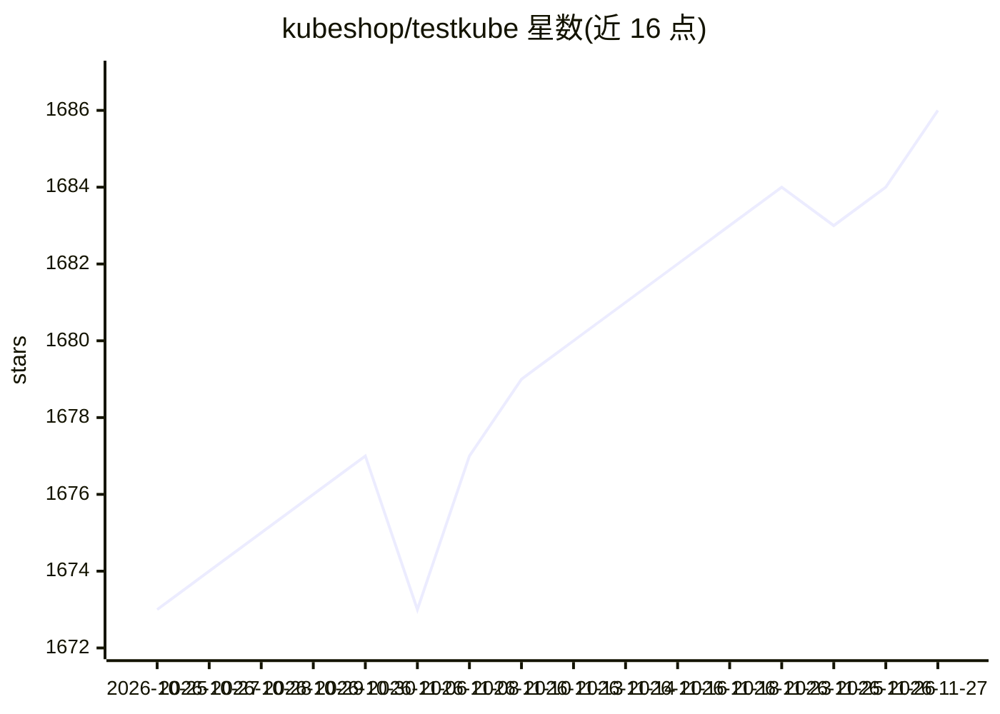

# kubeshop/testkube

⭐ 1,686 · Go · NOASSERTION · 推送 2026-11-26 · [GitHub](https://github.com/kubeshop/testkube) · [官网](https://testkube.io) · 组织维护

**为团队与 AI agent 提供统一的测试编排执行平台**

运行在 Kubernetes 集群中的开源测试编排 agent（MIT 许可）：支持创建、调度、执行与分析 API、E2E、性能、安全等各类测试，聚合测试结果、日志与产物用于集中报告。测试可手动触发、按计划、经 CI/CD/GitOps 流水线、Kubernetes 事件或 REST API/MCP 触发；通过 Webhook、REST API 与 MCP Server 与现有工具集成。另提供商业控制平面实现跨集群统一管理与 AI 工作流生成等功能。

## 筛选速览

| 维度 | 判定 | 备注 |
|---|---|---|
| AI 角色 | `ai-enhanced` | 去掉 AI 部分产品仍成立 |
| 许可风险 | `none` | NOASSERTION |
| 部署形态 | `None` |  |
| 模型依赖 | — | README 未给出锁定关系 |
| 硬件要求 | — | 无带数字的原话,不猜 |
| 安装摩擦 | `low` | 无编译、无系统依赖或容器化 |
| 成熟度 | — | 结构信号不足 |

## 能力要点

- 在自有 Kubernetes 集群内独立运行，无需控制平面
- 支持手动/定时/CI-CD/GitOps/K8s 事件/REST API/MCP 多种测试触发方式
- 聚合测试结果、产物、日志与资源指标做集中报告
- 提供 Testkube MCP Server 供 AI agent 集成

## 适用场景

- 在 Kubernetes 环境中统一编排和执行 API/E2E/性能等测试
- 把测试触发接入现有 CI/CD 与 GitOps 流水线
- 集中汇总多测试工具的结果与日志做故障排查
- 通过 MCP 让 AI agent 调用测试执行与分析能力

## 场景标签

 · 领域:DevOps/测试自动化

## 证据(README 行号)

> L7: Testkube gives teams and AI agents one place to create, orchestrate, execute and analyze any test in their existing 
> L25: - **Testkube AI**: Use the Testkube MCP Server or native AI Agents for troubleshooting, analysis, remediation, etc 
> L36: MIT-licensed, runs standalone in your Kubernetes cluster, no control plane required. Great for single-cluster setup

## 星数曲线

2026-10-25 1,673 → 2026-11-27 1,686（+13）

---
*卡片 v1 · prompt 1.4 · 生成 2026-11-24 · 置信度 high · 依据 README sha `3043f351b9cc` · [字段定义](../../DATASET.md)*
