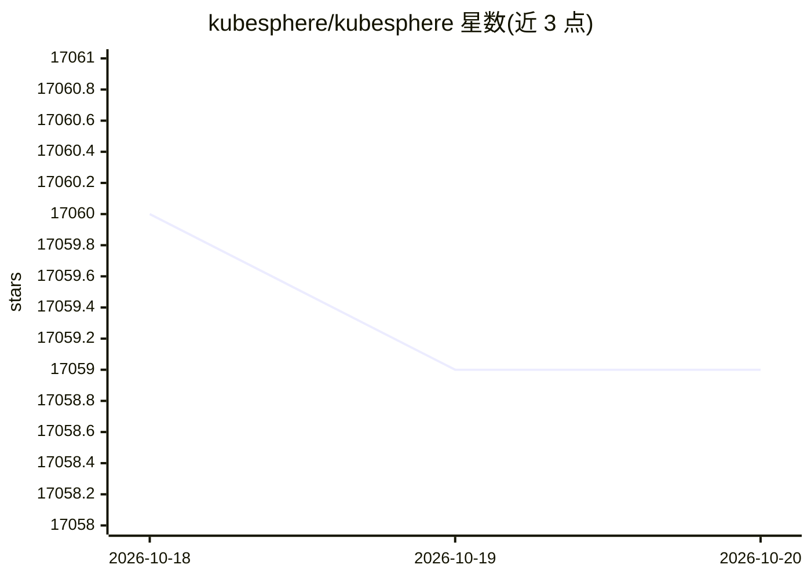

# kubesphere/kubesphere

⭐ 17,059 · Go · NOASSERTION · 推送 2026-07-15 · [GitHub](https://github.com/kubesphere/kubesphere) · [官网](https://kubesphere.io) · 组织维护 · 中文 README

**企业级 Kubernetes 容器平台：多云/多集群/边缘统一管理**

以 Kubernetes 为内核的分布式云原生应用管理系统，采用微内核+扩展组件架构（LuBan），核心仅含基础功能，功能模块以扩展组件形式在运行期动态管理。功能覆盖多集群集中管控与应用跨云分发、基于 Argo CD 与 Jenkins 的 DevOps 流水线、多租户 RBAC 与配额、监控告警日志、基于 Istio 的服务 Mesh、Helm 应用商店、集成 KubeEdge 的边缘部署、GPU 工作负载调度与配额管理。通过 Helm 在既有 K8s 集群安装，也托管于多家云厂商一键部署，支持离线（air-gapped）安装。

## 筛选速览

| 维度 | 判定 | 备注 |
|---|---|---|
| AI 角色 | `ai-ecosystem` | LLM/agent 周边工具 |
| 许可风险 | `none` | NOASSERTION |
| 部署形态 | `None` |  |
| 模型依赖 | — | README 未给出锁定关系 |
| 硬件要求 | — | 无带数字的原话,不猜 |
| 安装摩擦 | `low` | 无编译、无系统依赖或容器化 |
| 成熟度 | — | 结构信号不足 |

## 动量与使用信号

- 维护:`maintenance` — 距上次 push 95.3 天,年发版 0,120 位贡献者
- 涨星:近 1 天 **+0**(自 20261016 起算)
- 平台:WEB · 协议:—

## 能力要点

- 多集群集中控制面，支持应用跨云厂商分发
- 微内核+扩展组件架构（LuBan），运行期动态管理扩展
- 集成 KubeEdge 的边缘计算平台与 GPU 负载调度
- Helm 一条命令安装，支持离线 air-gapped 部署

## 适用场景

- 企业统一管理分布在不同云上的多个 Kubernetes 集群
- 为开发团队提供带 Web UI 的 DevOps 与 CI/CD 流水线
- 多租户场景下做角色权限与资源配额隔离
- 在边缘设备上部署应用并集中查看日志与监控

## 场景标签

 · 领域:云原生/容器平台

## 证据(README 行号)

> L3:  The container platform tailored for Kubernetes multi-cloud, datacenter, and edge management
> L75: KubeSphere 4.x adopts a microkernel + extension components architecture (codename LuBan). The core part (KubeSphere
> L97: helm upgrade --install -n kubesphere-system --create-namespace ks-core https://charts.kubesphere.io/main/ks-core-1.

## 星数曲线

2026-10-18 17,060 → 2026-10-20 17,059（-1）

---
*卡片 v1 · prompt 1.4 · 生成 2026-10-18 · 置信度 mid · 依据 README sha `5f513602aa8a` · [字段定义](../../DATASET.md)*
