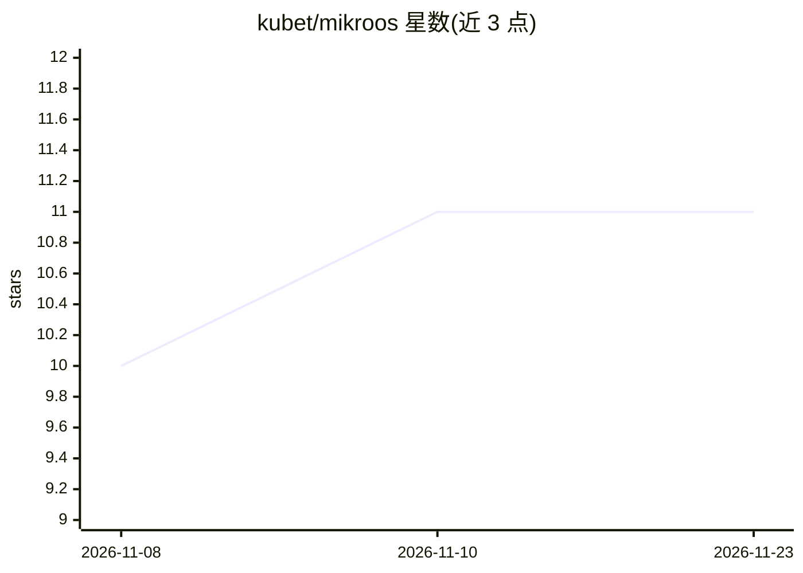

# kubet/mikroos

⭐ 11 · TypeScript · MIT · 推送 2026-04-20 · [GitHub](https://github.com/kubet/mikroos) · [官网](https://mikroos.com) · 个人维护

**浏览器内运行的本地 AI 编码代理，无需服务器与 API key**

MikroOS 是一个完全运行在浏览器标签页内的自包含编码代理：通过 WebLLM 或 Transformers.js 流式加载本地 LLM，在虚拟 Unix 沙箱（bash、文件系统、grep/sed/awk 等）中执行命令，并具备文件读写、网页搜索、HTML 预览等工具。模型权重、文件与会话历史均存储在 IndexedDB/localStorage，不经过远程 API。提供 git clone + npm 的源码运行方式，Qwen 模型需 WebGPU 浏览器支持，Bonsai 模型可回退到 WASM。README 声明其为工作原型而非生产软件。

## 筛选速览

| 维度 | 判定 | 备注 |
|---|---|---|
| AI 角色 | `ai-native` | 本体是模型或模型工具 |
| 许可风险 | `permissive` | MIT |
| 部署形态 | `library` | 以包/库形式分发 |
| 模型依赖 | — | README 未给出锁定关系 |
| 硬件要求 | — | 无带数字的原话,不猜 |
| 安装摩擦 | `low` | 无编译、无系统依赖或容器化 |
| 成熟度 | `idea` | |

## 能力要点

- 双 LLM 运行时：WebLLM（WebGPU）或 Transformers.js（ONNX，WebGPU→WASM 回退）
- 虚拟 Unix 沙箱含 bash、文件系统与包管理器 lifo install
- 10 个代理工具：bash/read/write/edit/grep/search/open/preview/todo/delegate
- 离线模式自动调整系统提示词，改为输出自包含 HTML

## 适用场景

- 在无服务器、无 API key 的环境下本地体验 AI 编码代理
- 在浏览器沙箱中让代理生成并预览 HTML 页面
- 离线或低网络环境下运行自包含的编码助手

## 场景标签

`编码 Agent` `AI 助手` · 领域:编码与开发

## 证据(README 行号)

> L3:  Browser-native AI coding agent.
> L18: MikroOS is a self-contained coding agent that lives in your browser. It streams a local LLM, executes shell command
> L21: - **Dual LLM runtime.** Runs WebLLM (Qwen via WebGPU) or 🤗 Transformers.js (Bonsai ONNX, with WebGPU → WASM fallbac

## 星数曲线

2026-11-08 10 → 2026-11-23 11（+1）

---
*卡片 v1 · prompt 1.4 · 生成 2026-11-18 · 置信度 high · 依据 README sha `ad5895393c4d` · [字段定义](../../DATASET.md)*
