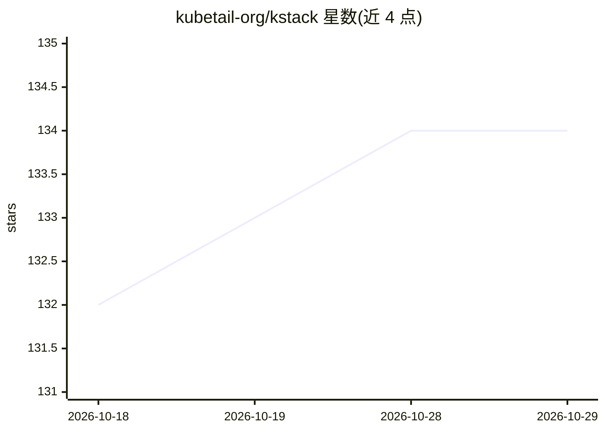

# kubetail-org/kstack

⭐ 134 · Shell · Apache-2.0 · 推送 2026-09-29 · [GitHub](https://github.com/kubetail-org/kstack) · [官网](https://kstack.sh) · 组织维护 · 中文 README

**给 Claude Code 等 AI agent 的 K8s 监控与排障技能包**

面向 Claude Code 及其他支持 skills 的 AI agent（Codex/OpenCode/Cursor 等）的 Kubernetes 运维技能包，安装后提供 /cluster-status、/events、/investigate、/logs、/metrics、/exec 及安全/网络/成本/版本四类审计等斜杠命令。机制上把 shell 工作交给 kubectl、Kubetail、Helm、Trivy、Pluto 等工具执行后再交给 agent 处理，配合 tmux 共享会话与本地缓存以节省 token；所有技能默认只读，变更需确认，认证走本地 kubeconfig 并受 RBAC 约束。通过 curl 脚本安装。

## 筛选速览

| 维度 | 判定 | 备注 |
|---|---|---|
| AI 角色 | `ai-ecosystem` | LLM/agent 周边工具 |
| 许可风险 | `permissive` | Apache-2.0 |
| 部署形态 | `library` | 以包/库形式分发 |
| 模型依赖 | locked-api |  |
| 硬件要求 | — | 无带数字的原话,不猜 |
| 安装摩擦 | `medium` | 含编译或系统依赖之一 |
| 成熟度 | — | 结构信号不足 |

## 能力要点

- 13 个技能命令覆盖监控、排障、审计与清理
- 适配 8 种 agent CLI（Claude/Codex/OpenCode/Cursor 等），curl 脚本自动检测安装
- shell 工作交给 kubectl/Kubetail/Helm/Trivy/Pluto 执行后再交给 agent，保持响应快与省 token
- 技能默认只读、遵循 kubeconfig RBAC，变更集群状态需显式确认

## 适用场景

- 在 agent 会话里用自然语言查询集群健康、事件与指标
- 让 AI 排查故障资源的根因并跟进日志与 exec 操作
- 对集群做安全、网络、成本与过时版本的审计

## 场景标签

`Agent 框架` · 领域:Agent 开发

## 证据(README 行号)

> L15: **Kstack** is a skill pack for Claude Code that helps you perform monitoring, troubleshooting and auditing tasks on
> L69: Kstack works with any AI agent that supports skills, not just Claude. The curl bootstrap auto-detects which agent C

## 星数曲线

2026-10-18 132 → 2026-10-29 134（+2）

---
*卡片 v1 · prompt 1.4 · 生成 2026-10-22 · 置信度 high · 依据 README sha `70da15328426` · [字段定义](../../DATASET.md)*
