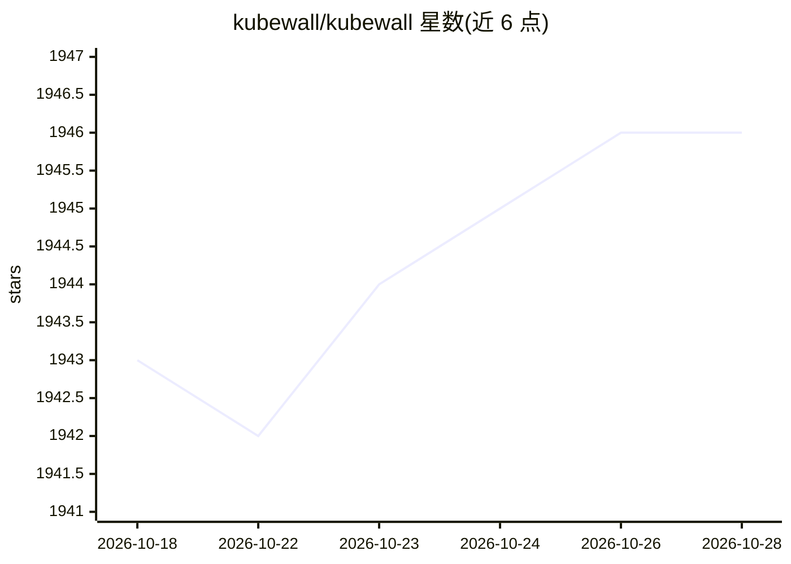

# kubewall/kubewall

⭐ 1,946 · TypeScript · Apache-2.0 · 推送 2026-10-18 · [GitHub](https://github.com/kubewall/kubewall) · 组织维护

**单二进制自托管 Kubernetes 多集群管理面板，带 AI 排障**

开源的单二进制 Kubernetes 仪表盘，通过浏览器实时管理多个集群：查看与编辑资源清单、流式聚合 Pod 日志、实时监控与指标、端口转发、搜索过滤、扩缩容与 rollout 重启等操作。AI 集成支持 OpenAI、Claude 4、Gemini、DeepSeek、OpenRouter、Ollama、Qwen、LMStudio 等模型，用于自动排障、配置优化与建议。本地运行零云端依赖，提供 Docker、Helm、Homebrew、Snap、Winget、Scoop 及多平台预编译二进制等安装方式。

## 筛选速览

| 维度 | 判定 | 备注 |
|---|---|---|
| AI 角色 | `ai-enhanced` | 去掉 AI 部分产品仍成立 |
| 许可风险 | `permissive` | Apache-2.0 |
| 部署形态 | `self-host` | docker 或自建部署 |
| 模型依赖 | local-ok | 支持本地模型 |
| 硬件要求 | — | 无带数字的原话,不猜 |
| 安装摩擦 | `low` | 无编译、无系统依赖或容器化 |
| 成熟度 | — | 结构信号不足 |

## 能力要点

- 单二进制部署，支持 Mac/Windows/Linux，零配置
- 多集群统一管理，浏览器访问，零云端依赖
- 可接入 OpenAI/Claude/Gemini/Ollama 等多家 AI 提供商做排障与建议
- 聚合 Pod 日志、端口转发、实时刷新与资源一键操作

## 适用场景

- 运维人员在一个界面管理多个 Kubernetes 集群
- 在浏览器中查看日志、清单并调试集群问题
- 借助 AI 分析集群故障与配置优化建议

## 场景标签

 · 领域:云原生/DevOps 工具

## 证据(README 行号)

> L8: **kubewall** is a Open-Source, Single-Binary Kubernetes Dashboard with Multi-Cluster Management & AI Integration.
> L15: |🤖 **AI-Powered**|Leverage AI (OpenAI / Claude 4 / Gemini / DeepSeek / OpenRouter / Ollama / Qwen / LMStudio) for a
> L17: |🚀 **Single-Binary Deployment**|Install effortlessly as a lightweight binary on Mac, Windows, or Linux - no depende

## 星数曲线

2026-10-18 1,943 → 2026-10-28 1,946（+3）

---
*卡片 v1 · prompt 1.4 · 生成 2026-10-21 · 置信度 high · 依据 README sha `247a6c4e0a59` · [字段定义](../../DATASET.md)*
