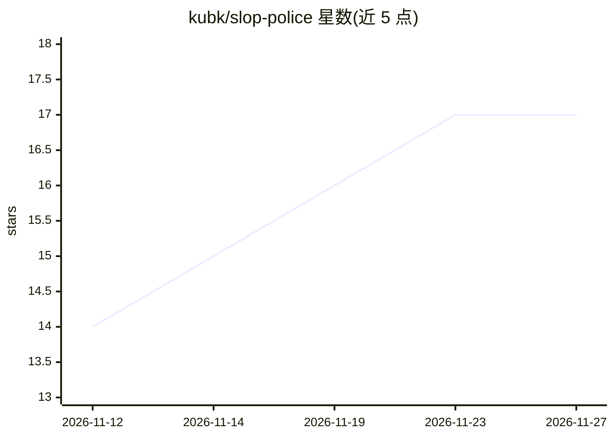

# kubk/slop-police

⭐ 17 · Go · MIT · 推送 2026-11-24 · [GitHub](https://github.com/kubk/slop-police) · [官网](https://www.npmjs.com/package/slop-police) · 个人维护

**检测 LLM 生成代码坏味道的 TypeScript 静态分析工具**

面向 TypeScript 项目（含 monorepo）的静态分析/lint 工具，定位是捕捉 LLM 生成代码常见问题：直传包装函数、仅改名的类型别名与变量、重复代码/重复函数、未使用的导出、枚举成员、对象键与类成员、未解析导入等。核心机制是先跨所有 tsconfig 项目链接全部用法再报告，而非逐文件分析。通过 npm/npx 运行，需 macOS/Linux(arm64/x64，Windows 用 WSL) 与 Node.js 22.18+，自带 TypeScript 7 编译器。支持 JSON 配置、CI 集成、插件自定义规则与行内忽略注释。

## 筛选速览

| 维度 | 判定 | 备注 |
|---|---|---|
| AI 角色 | `ai-enhanced` | 去掉 AI 部分产品仍成立 |
| 许可风险 | `permissive` | MIT |
| 部署形态 | `library` | 以包/库形式分发 |
| 模型依赖 | — | README 未给出锁定关系 |
| 硬件要求 | — | 无带数字的原话,不猜 |
| 安装摩擦 | `low` | 无编译、无系统依赖或容器化 |
| 成熟度 | — | 结构信号不足 |

## 能力要点

- 跨项目链接全部用法后再报告，检测跨文件的未使用导出/成员/键
- 内置 11+ 条规则：直传包装、重复代码、未使用导出/枚举/对象键/类成员等
- 支持 TypeScript/JavaScript 编写插件自定义规则（defineRule API）
- 内存策略：默认最多用机器内存 1/4，可用 SLOP_POLICE_MEMORY_GB 调整

## 适用场景

- AI 辅助编码后清理生成代码中的冗余与无用代码
- CI 中用 npx slop-police 拦截未使用导出与重复实现
- monorepo 级别的死代码与重复函数检测

## 场景标签

`代码审查` · 领域:编码与开发

## 证据(README 行号)

> L1: slop-police: Stop LLM crimes in your codebase
> L7:  slop-police flags a function that just forwards, a variable that is just a rename, and a method that is never calle
> L259: ## Why not ESLint / Oxlint / tsgolint?

## 星数曲线

2026-11-12 14 → 2026-11-27 17（+3）

---
*卡片 v1 · prompt 1.4 · 生成 2026-11-18 · 置信度 high · 依据 README sha `f83f7d4332a4` · [字段定义](../../DATASET.md)*
