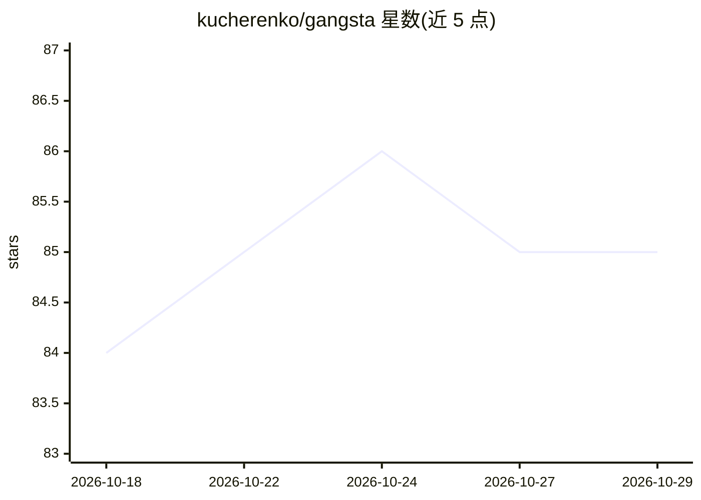

# kucherenko/gangsta

⭐ 85 · Shell · MIT · 推送 2026-10-27 · [GitHub](https://github.com/kucherenko/gangsta) · [官网](https://gangsta.page) · 个人维护

**给 AI 编码 agent 的黑帮组织化技能框架，用规格驱动开发**

面向 Cursor、Claude Code、GitHub Copilot、OpenCode、Codex、Gemini CLI 等 AI 编码 agent 的技能框架：以'规格即法律'为核心，将开发流程组织为 6 阶段 Heist 流水线（侦察、对抗式头脑风暴、规格起草、任务分解、并行执行、交付验证），每阶段需用户批准。角色体系含 Don、Consigliere、Underboss 等层级，配套 TDD 强制、Git worktree 隔离、代码审查等技能，以及跨会话的家族账本（经验/失败/戒律）。通过 npx skills CLI 或各 agent 插件市场安装。

## 筛选速览

| 维度 | 判定 | 备注 |
|---|---|---|
| AI 角色 | `ai-ecosystem` | LLM/agent 周边工具 |
| 许可风险 | `permissive` | MIT |
| 部署形态 | `library` | 以包/库形式分发 |
| 模型依赖 | — | README 未给出锁定关系 |
| 硬件要求 | — | 无带数字的原话,不猜 |
| 安装摩擦 | `low` | 无编译、无系统依赖或容器化 |
| 成熟度 | — | 结构信号不足 |

## 能力要点

- 6 阶段规格驱动 Heist 流水线，每阶段设用户审批门
- Don/Consigliere/Underboss/Worker 层级化 agent 角色体系
- 家族账本跨会话沉淀成功经验、失败诊断与戒律
- 支持 Cursor/Claude Code/Copilot/OpenCode/Codex/Gemini CLI 六类 agent 安装

## 适用场景

- 让编码 agent 按规格先行、阶段审批的流程开发功能
- 给通用 AI agent 增加系统化调试与 TDD 强制技能
- 在多 agent 协作中引入层级治理与状态文件化检查点

## 场景标签

`编码 Agent` `多智能体` `Agent 框架` · 领域:Agent 开发

## 证据(README 行号)

> L5: An AI agentic skills framework for spec-driven development, built on the organizational model of mafia.
> L17: When you start a session, the framework bootstraps The Don — an orchestrator that analyzes your intent and routes t

## 星数曲线

2026-10-18 84 → 2026-10-29 85（+1）

---
*卡片 v1 · prompt 1.4 · 生成 2026-10-24 · 置信度 high · 依据 README sha `a2a1f0fa4c9e` · [字段定义](../../DATASET.md)*
