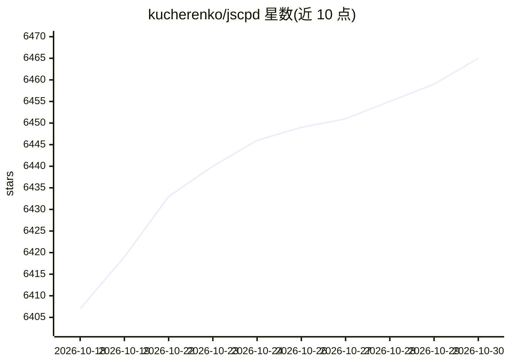

# kucherenko/jscpd

⭐ 6,465 · Rust · MIT · 推送 2026-10-28 · [GitHub](https://github.com/kucherenko/jscpd) · [官网](https://jscpd.dev) · 个人维护

**面向开发者的源码复制粘贴与代码健康检测 CLI（224 种格式）**

Rust 引擎的代码克隆检测工具：按各语言自身规则分词，用滚动 Rabin-Karp 哈希查找跨文件的重复 token 序列，支持 Type-2（改名）、Type-3（近似）与实验性 Type-4（基于代码嵌入模型的语义克隆）检测。另提供死代码分析、复杂度排名、git 历史趋势与 0-100 健康评分。以自包含二进制发布到 npm/PyPI/crates.io/Homebrew/Nix/Docker 及 GitHub Action，内置 MCP server 与 LSP 语言服务器，供开发者与 AI agent 在 CI 和编辑器中使用。

## 筛选速览

| 维度 | 判定 | 备注 |
|---|---|---|
| AI 角色 | `ai-enhanced` | 去掉 AI 部分产品仍成立 |
| 许可风险 | `permissive` | MIT |
| 部署形态 | `self-host` | docker 或自建部署 |
| 模型依赖 | — | README 未给出锁定关系 |
| 硬件要求 | — | 无带数字的原话,不猜 |
| 安装摩擦 | `low` | 无编译、无系统依赖或容器化 |
| 成熟度 | `idea` | |

## 能力要点

- 224 种格式的语言感知分词与跨格式克隆检测
- Type-2/3/4 克隆检测，Type-4 实验性使用代码嵌入模型
- 死代码、复杂度、git 历史趋势与健康评分分析
- 内置 MCP server（--mcp）与 LSP 语言服务器（--lsp）

## 适用场景

- 在 CI 中检测新增重复代码并按阈值拦截
- 对比两份代码库找出未移植的函数
- 让 AI agent 通过 MCP 检查代码片段与已有代码的克隆关系

## 场景标签

`代码审查` · 领域:编码与开发

## 证据(README 行号)

> L16: > Duplicate code detector for 220+ languages — plus dead code, complexity hotspots, duplication and health trends o
> L109: - **`--mcp`** — built-in MCP server over stdio with fully described tools: point your AI assistant at the binary a
> L111: - **AI reporter** — token-efficient output for LLM pipelines (~79% fewer tokens than console)

## 星数曲线

2026-10-18 6,407 → 2026-10-30 6,465（+58）

---
*卡片 v1 · prompt 1.4 · 生成 2026-10-20 · 置信度 high · 依据 README sha `5afada1c0140` · [字段定义](../../DATASET.md)*
