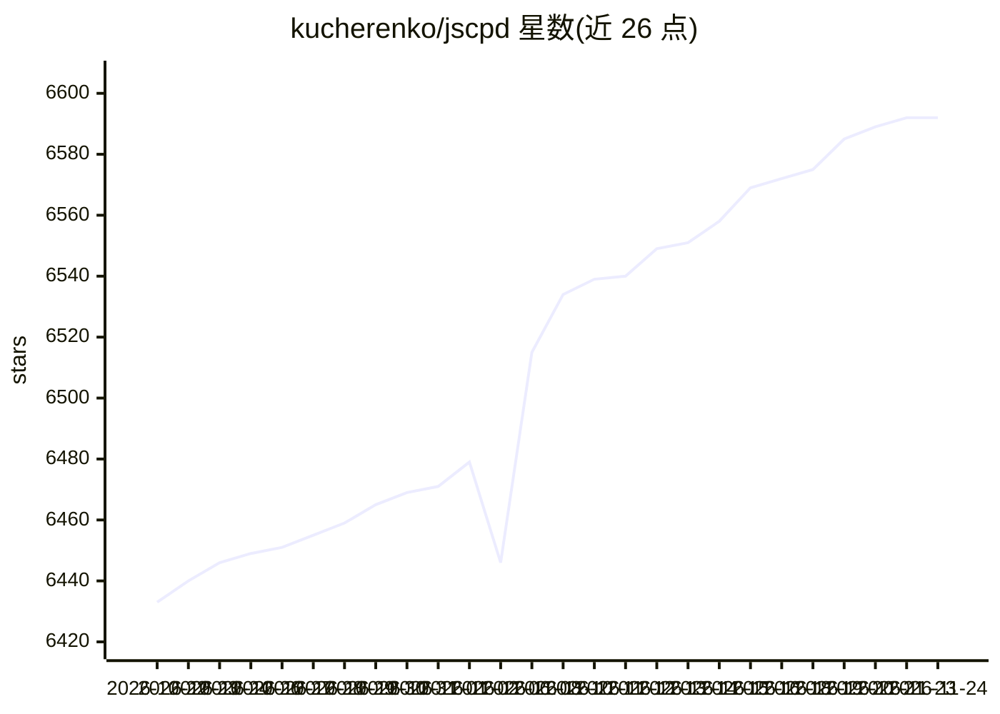

# kucherenko/jscpd

⭐ 6,592 · Rust · MIT · 推送 2026-11-22 · [GitHub](https://github.com/kucherenko/jscpd) · [官网](https://jscpd.dev) · 个人维护

**面向开发者的源码重复代码检测器，支持 224 种语言并集成 MCP 供 AI 使用**

用 Rust 编写的代码重复检测工具，按各语言自身语法做分词，用 Rabin-Karp 滚动哈希跨文件查找重复 token 序列，支持 Type-2（改名）、Type-3（近似）、Type-4（语义，实验性，可接 OpenAI 兼容嵌入 API）三层检测。另提供死代码查找、复杂度排名、git 历史趋势和 0-100 健康分。以自包含二进制分发，无运行时依赖，带 15 种报告器、GitHub Action、LSP、MCP 服务器与省 token 的 ai 报告器。

## 筛选速览

| 维度 | 判定 | 备注 |
|---|---|---|
| AI 角色 | `ai-enhanced` | 去掉 AI 部分产品仍成立 |
| 许可风险 | `permissive` | MIT |
| 部署形态 | `self-host` | docker 或自建部署 |
| 模型依赖 | — | README 未给出锁定关系 |
| 硬件要求 | — | 无带数字的原话,不猜 |
| 安装摩擦 | `low` | 无编译、无系统依赖或容器化 |
| 成熟度 | — | 结构信号不足 |

## 能力要点

- 224 种语言感知分词，Rabin-Karp 检测 exact/renamed/similar 三类克隆
- 实验性语义检测可自建嵌入模型或接任意 OpenAI 兼容 API
- 内置 stdio MCP 服务器与省 token 的 ai 报告器供 AI agent 调用
- 死代码、复杂度、git 历史趋势与健康评分等扩展分析

## 适用场景

- CI 中以阈值或基线门禁阻止新增重复代码
- 让 AI 编码助手通过 MCP 检查代码库中的克隆
- 审查 monorepo 中跨团队的重复实现与重构热点
- 统计项目死代码与复杂度并生成健康评分

## 场景标签

`代码审查` · 领域:编码与开发

## 证据(README 行号)

> L16: > Duplicate code detector for 220+ languages — plus dead code, complexity hotspots, duplication and health trends o
> L109: - **`--mcp`** — built-in MCP server over stdio with fully described tools: point your AI assistant at the binary a
> L111: - **AI reporter** — token-efficient output for LLM pipelines (~79% fewer tokens than console)

## 星数曲线

2026-10-22 6,433 → 2026-11-24 6,592（+159）

---
*卡片 v1 · prompt 1.4 · 生成 2026-11-22 · 置信度 high · 依据 README sha `16a3526faa31` · [字段定义](../../DATASET.md)*
