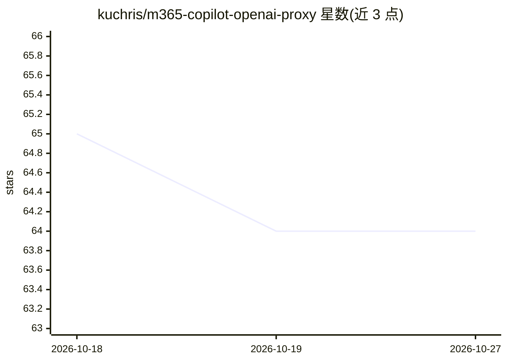

# kuchris/m365-copilot-openai-proxy

⭐ 64 · Python · Apache-2.0 · 推送 2026-10-07 · [GitHub](https://github.com/kuchris/m365-copilot-openai-proxy) · 个人维护

**本地代理：把 M365 Copilot 封装为 OpenAI 兼容 API**

基于 FastAPI 的本地代理服务器，通过 substrate.office.com WebSocket API（与 M365 Copilot 网页端相同通道）通信，将其暴露为 OpenAI Chat Completions/Responses 及 Anthropic Messages 风格的 HTTP 端点，供 OpenAI 兼容客户端、本地脚本和编码工具调用。无需 Azure 应用注册或管理员同意，用浏览器登录会话即可；自动捕获并刷新短时 token（依赖已登录的 Edge 配置文件）。限制：非官方代理、不支持工具调用、token 用量为占位值。使用 uv 安装运行。

## 筛选速览

| 维度 | 判定 | 备注 |
|---|---|---|
| AI 角色 | `ai-ecosystem` | LLM/agent 周边工具 |
| 许可风险 | `permissive` | Apache-2.0 |
| 部署形态 | `None` |  |
| 模型依赖 | locked-api |  |
| 硬件要求 | — | 无带数字的原话,不猜 |
| 安装摩擦 | `low` | 无编译、无系统依赖或容器化 |
| 成熟度 | — | 结构信号不足 |

## 能力要点

- 暴露 OpenAI Chat Completions/Responses 与 Anthropic Messages 风格端点
- 自动捕获与刷新浏览器 token（默认 127.0.0.1 监听）
- 通过 X-M365-Session-Id 或 m365-copilot:persist 支持持久 Copilot 会话
- 提供 /healthz 与 /v1/token/status 健康检查

## 适用场景

- 让 OpenAI 兼容客户端（OpenCode/Continue/Claude Code）调用公司已有的 M365 Copilot
- 在本地脚本中复用 M365 Copilot 会话进行问答
- 跨轮对话中保持同一 Copilot 会话上下文

## 场景标签

 · 领域:LLM 基础设施/API 代理

## 证据(README 行号)

> L3: Use Microsoft 365 Copilot through OpenAI-compatible clients, local scripts, and coding tools.
> L5: This project runs a local FastAPI proxy that talks to the same `substrate.office.com` WebSocket API used by the M365
> L183: |`POST /v1/chat/completions`|OpenAI Chat Completions, streaming supported|

## 星数曲线

2026-10-18 65 → 2026-10-27 64（-1）

---
*卡片 v1 · prompt 1.4 · 生成 2026-10-24 · 置信度 high · 依据 README sha `bb04f33df845` · [字段定义](../../DATASET.md)*
