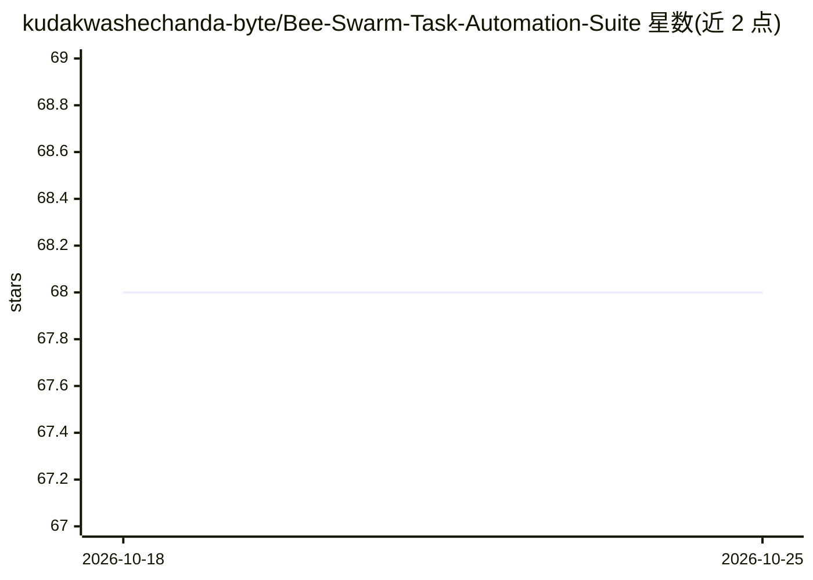

# kudakwashechanda-byte/Bee-Swarm-Task-Automation-Suite

⭐ 68 · HTML · 推送 2026-10-25 · [GitHub](https://github.com/kudakwashechanda-byte/Bee-Swarm-Task-Automation-Suite) · 个人维护

**Windows 平台的 Bee Swarm Simulator 游戏自动化陪伴工具套件**

面向 Roblox 游戏 Bee Swarm Simulator 2026 版的用户态自动化工具：读取本地游戏内存做模式匹配，提供 11 个可独立开关的模块，包括蜂群状态快照、田地路径规划与 ESP 路线叠加、花粉产量统计与 CSV 导出、平滑移动辅助、任务进度记录、稀有刷新通知、本地物品镜像、快捷键管理与 14 种语言的界面切换。主进程不含网络调用与遥测，配置以 INI 文件保存，支持便携模式与无界面运行。仅限 Windows，覆盖 Windows 10/11 各版本。

## 筛选速览

| 维度 | 判定 | 备注 |
|---|---|---|
| AI 角色 | `ai-enhanced` | 去掉 AI 部分产品仍成立 |
| 许可风险 | `permissive` | — |
| 部署形态 | `None` |  |
| 模型依赖 | — | README 未给出锁定关系 |
| 硬件要求 | — | 无带数字的原话,不猜 |
| 安装摩擦 | `low` | 无编译、无系统依赖或容器化 |
| 成熟度 | — | 结构信号不足 |

## 能力要点

- 11 个模块化功能，可单独启停，含 ESP 路线叠加与路径规划
- 读取内存做模式匹配，默认只读、按需开启写入功能
- 14 种语言包运行时切换，无需重启
- 无网络调用、无遥测，状态文件为本地纯文本

## 适用场景

- 长时间重复采集时自动化花粉收割路线
- 记录任务进度与物品库存，方便中断后继续
- 统计各蜜蜂与田地产量并导出 CSV 分析

## 场景标签

`GUI 自动化` · 领域:效率与自动化

## 证据(README 行号)

> L57: |Hive Awareness Engine|Reads local game state for pattern matching|Enabled|
> L74: This is the sensory cortex. Rather than injecting arbitrary payloads, it observes memory patterns that already exis

## 星数曲线

2026-10-18 68 → 2026-10-25 68（+0）

---
*卡片 v1 · prompt 1.4 · 生成 2026-10-24 · 置信度 mid · 依据 README sha `1cc79658d6de` · [字段定义](../../DATASET.md)*
