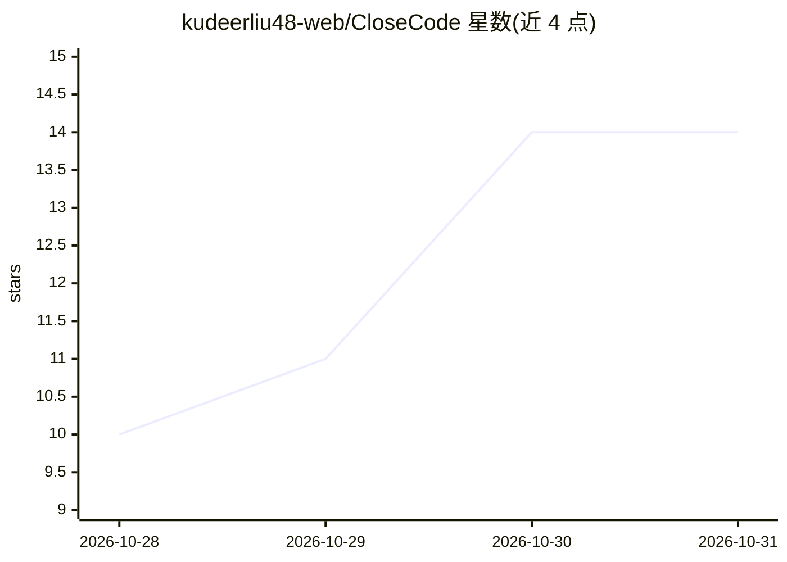

# kudeerliu48-web/CloseCode

⭐ 14 · JavaScript · NOASSERTION · 推送 2026-10-27 · [GitHub](https://github.com/kudeerliu48-web/CloseCode) · [官网](https://github.com/kudeerliu48-web/CloseCode) · 个人维护 · 中文 README

**本地优先的桌面/自托管 AI Agent 工作台，一站式接入多家大模型**

面向开发与日常办公的 AI Agent 工作台，支持 OpenAI、Anthropic 接口及 DeepSeek、通义千问、智谱 GLM、Kimi、Ollama 等 OpenAI 兼容服务，可配置 Ollama 本地模型。Agent 可结合工具（文件读写、Node.js/Shell 执行、网页搜索抓取）、技能、专家团队与 MCP 连接器完成研究、代码、文档与数据处理任务，成果写入工作区，并支持多任务并行、定时任务、Git 自动同步、Token 用量统计与上下文自动压缩。提供 Electron 桌面版、Node.js 自托管服务与 CLI 三种入口，可选 Cloudflare Tunnel 手机远程控制。许可证为 PolyForm Noncommercial 1.0.0（非商业限制，非 OSI 开源许可）。

## 筛选速览

| 维度 | 判定 | 备注 |
|---|---|---|
| AI 角色 | `ai-native` | 本体是模型或模型工具 |
| 许可风险 | `none` | NOASSERTION |
| 部署形态 | `self-host` | docker 或自建部署 |
| 模型依赖 | local-ok | 支持本地模型 |
| 硬件要求 | — | 无带数字的原话,不猜 |
| 安装摩擦 | `low` | 无编译、无系统依赖或容器化 |
| 成熟度 | `idea` | |

## 能力要点

- 支持 OpenAI/Anthropic 接口及多家国产模型与 Ollama 等 OpenAI 兼容服务
- Electron 桌面版 / Node.js 服务端 / CLI 三种运行形态，另提供 Docker Compose
- Agent 工具覆盖文件编辑、Shell 执行、网页抓取与图表生成，可产出 Word/Excel/PPT/HTML
- 技能创建导入导出、专家团队协作、MCP 与插件扩展

## 适用场景

- 在本机一站式配置并使用多家大模型完成研究、代码与文档任务
- 配置 Ollama 本地模型以减少对远程模型 API 的依赖
- 通过手机浏览器远程连接本机工作台执行任务

## 场景标签

`AI 助手` `编码 Agent` `网页抓取` · 领域:效率与自动化

## 证据(README 行号)

> L20: **面向开发与日常办公的本地优先 AI Agent 工作台。** CloseCode 提供快捷的一站式模型配置，兼容 OpenAI、Anthropic 等主流大模型服务及 OpenAI 兼容接口，支持预设或自定义请求地址，帮助用户
> L22: 支持 Electron 桌面应用、Node.js 自托管服务和命令行入口。项目数据与成果保存在本机；使用远程模型时，对话上下文会发送给你配置的模型服务商。配置 Ollama 等本地模型可减少对远程模型 API 的依赖，但联网搜索等

## 星数曲线

2026-10-28 10 → 2026-10-31 14（+4）

---
*卡片 v1 · prompt 1.4 · 生成 2026-10-31 · 置信度 high · 依据 README sha `362de3506aaf` · [字段定义](../../DATASET.md)*
