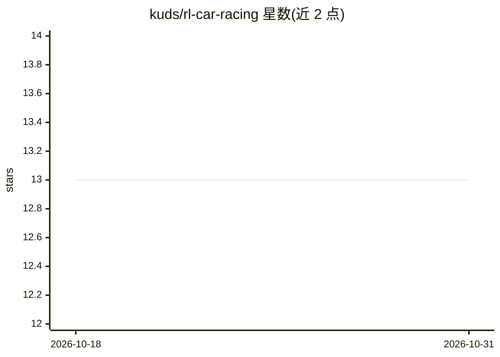

# kuds/rl-car-racing

⭐ 13 · Jupyter Notebook · MIT · 推送 2026-04-25 · [GitHub](https://github.com/kuds/rl-car-racing) · 个人维护

**用强化学习求解 Gymnasium CarRacing 的代码与 notebook 集合**

包含 SAC、DQN、PPO 三种算法训练 Gymnasium CarRacing 环境的代码与 Jupyter notebook，基于 Stable Baselines3 实现。README 给出三种算法在 Google Colab L4 上的训练结果（平均奖励、训练时长、总步数），模型托管在 HuggingFace。训练笔记记录 ent_coef、eval_freq、buffer_size、灰度化观察空间等超参数对稳定性与显存占用的影响。给关注强化学习实验复现的开发者与学习者使用。

## 筛选速览

| 维度 | 判定 | 备注 |
|---|---|---|
| AI 角色 | `ai-native` | 本体是模型或模型工具 |
| 许可风险 | `permissive` | MIT |
| 部署形态 | `None` |  |
| 模型依赖 | — | README 未给出锁定关系 |
| 硬件要求 | — | 无带数字的原话,不猜 |
| 安装摩擦 | `low` | 无编译、无系统依赖或容器化 |
| 成熟度 | — | 结构信号不足 |

## 能力要点

- SAC/DQN/PPO 三种算法的训练实现
- 三种算法在 Colab L4 上的奖励与训练时长对照表
- 模型上传至 HuggingFace
- 灰度化观察空间以降低内存占用的训练技巧

## 适用场景

- 复现或对比 SAC/DQN/PPO 在 CarRacing 上的训练效果
- 在 Colab 上学习强化学习超参数调优实践
- 获取调参经验（ent_coef、buffer_size、eval_freq）

## 场景标签

`强化学习` `教程课程` · 领域:学习与行业

## 证据(README 行号)

> L3: ## Soft-Actor Critic (SAC)
> L5: ## Deep Q Learning (DQN)
> L7: ## Proximal Policy Optimization (PPO)

## 星数曲线

2026-10-18 13 → 2026-10-31 13（+0）

---
*卡片 v1 · prompt 1.4 · 生成 2026-10-31 · 置信度 high · 依据 README sha `b9ca7380a7fd` · [字段定义](../../DATASET.md)*
