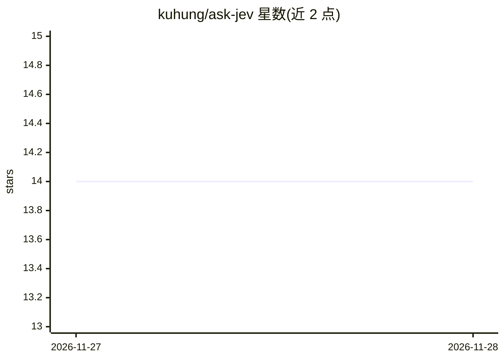

# kuhung/ask-jev

⭐ 14 · TypeScript · 推送 2026-11-26 · [GitHub](https://github.com/kuhung/ask-jev) · [官网](https://askjev.kuhung.me) · 个人维护 · 中文 README

**为日常小抉择提供即时判定的复古风决策小工具**

一个 Neo-Brutalist 90 年代风格的网页决策应用：将日常两难问题映射到三个单步决策原语——noul（是/否二元判定含置信度）、choice（从候选中选一）、score（对选择合理性/冲动度打分）。内置本地回退引擎，配置外部 Jev 决策 API 端点后可用在线判定，API key 仅在服务端使用。提供 Next.js 开发模式与免安装的独立 index.html 两种运行方式。

## 筛选速览

| 维度 | 判定 | 备注 |
|---|---|---|
| AI 角色 | `ai-enhanced` | 去掉 AI 部分产品仍成立 |
| 许可风险 | `none` | — |
| 部署形态 | `library` | 以包/库形式分发 |
| 模型依赖 | — | README 未给出锁定关系 |
| 硬件要求 | — | 无带数字的原话,不猜 |
| 安装摩擦 | `low` | 无编译、无系统依赖或容器化 |
| 成熟度 | — | 结构信号不足 |

## 能力要点

- 三种单步决策原语：noul 二元判定 / choice 选一 / score 冲动度评分
- 内置本地回退引擎，无 API key 也能运行
- 独立 index.html 双击即可使用
- 一键复制判定引语与彩带锁定等交互效果

## 适用场景

- 快速决定要不要买某个东西/今晚去不去
- 在两个候选选项之间选一个（如午餐吃什么）
- 给某个冲动消费选择打个合理性分数

## 场景标签

`AI 助手` · 领域:对话与助手

## 证据(README 行号)

> L16: Instead of asking a slow LLM to write a balanced essay about whether you should buy a new phone or what to eat for 
> L22: Built with a 90s Ask Jeeves homage aesthetic (cream ground, thick hard-shadow borders, SVG butler portrait, one-cli
> L42: If omitted, the `/api/jev` route gracefully falls back to the built-in local decision engine (`lib/mockJev.ts`) so 

## 星数曲线

2026-11-27 14 → 2026-11-28 14（+0）

---
*卡片 v1 · prompt 1.4 · 生成 2026-11-27 · 置信度 mid · 依据 README sha `68a5cd6d8857` · [字段定义](../../DATASET.md)*
