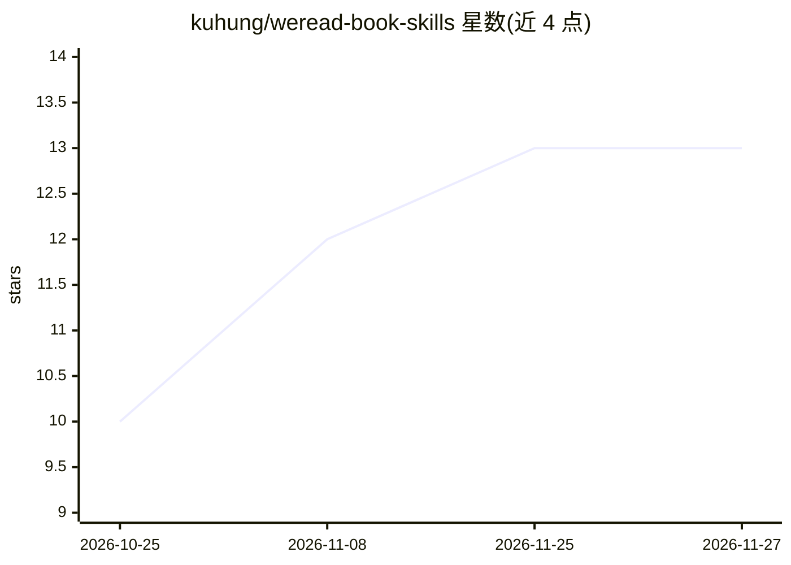

# kuhung/weread-book-skills

⭐ 13 · Shell · MIT · 推送 2026-07-18 · [GitHub](https://github.com/kuhung/weread-book-skills) · 个人维护 · 中文 README

**把微信读书笔记编译成可挂载的 AI Agent 技能**

仓库提供 26 个由作者微信读书划线与想法编译成的 SKILL.md 技能，按管理、组织战略、销售、产品、个人成长、投资六类组织；提供 book-to-skill 五步流水线（存档原始划线、结构化重组、提取技能、更新 README、软链接分发），支持 fork 后用自己的微信读书数据编译新技能。通过 install.sh 将技能软链接挂载到 Claude Code、Cursor、Codex、Gemini CLI，Agent 按 description 触发场景路由匹配后分层加载。前置依赖为官方 weread skill 及其 API Key；private 目录经 gitignore 隔离原始划线。

## 筛选速览

| 维度 | 判定 | 备注 |
|---|---|---|
| AI 角色 | `ai-knowledge` | 知识聚合/清单类 |
| 许可风险 | `permissive` | MIT |
| 部署形态 | `None` |  |
| 模型依赖 | — | README 未给出锁定关系 |
| 硬件要求 | — | 无带数字的原话,不猜 |
| 安装摩擦 | `low` | 无编译、无系统依赖或容器化 |
| 成熟度 | — | 结构信号不足 |

## 能力要点

- 26 个 SKILL.md 技能按六大使用场景组织，附 notes 理论笔记
- book-to-skill 五步流水线支持用个人微信读书数据编译新技能
- install.sh 软链接分发到 Claude Code / Cursor / Codex / Gemini CLI 四家 Agent
- skills 目录为唯一事实源，实战修正经 Field Notes 写回

## 适用场景

- 开会或辅导下属时让 AI 按读过的书提供方法论
- 把自己的微信读书划线整理成可触发的技能
- 多个 AI 编码工具间共享同一套技能库

## 场景标签

`知识库管理` `提示工程` · 领域:Agent 开发

## 证据(README 行号)

> L11: 本仓库做的事：把微信读书里的划线与想法，编译成 `SKILL.md` 技能指令，一次挂载，Claude Code / Cursor / Codex / Gemini CLI 四家通用。当你的对话匹配某个技能的触发条件时，AI 自动
> L42: 26 个技能，为作者的阅读记录提取，按**使用场景**分六类。书名可点进对应的 `SKILL.md`。
> L104: 数据漏斗：藏书 356 本 → 有个人划线 131 本 → 方法论候选约 24 本 → 已成技能 26 个，决定能否成技能的是方法论密度，跟划线数量关系不大

## 星数曲线

2026-10-25 10 → 2026-11-27 13（+3）

---
*卡片 v1 · prompt 1.4 · 生成 2026-11-18 · 置信度 high · 依据 README sha `5cd0cc2b8aee` · [字段定义](../../DATASET.md)*
