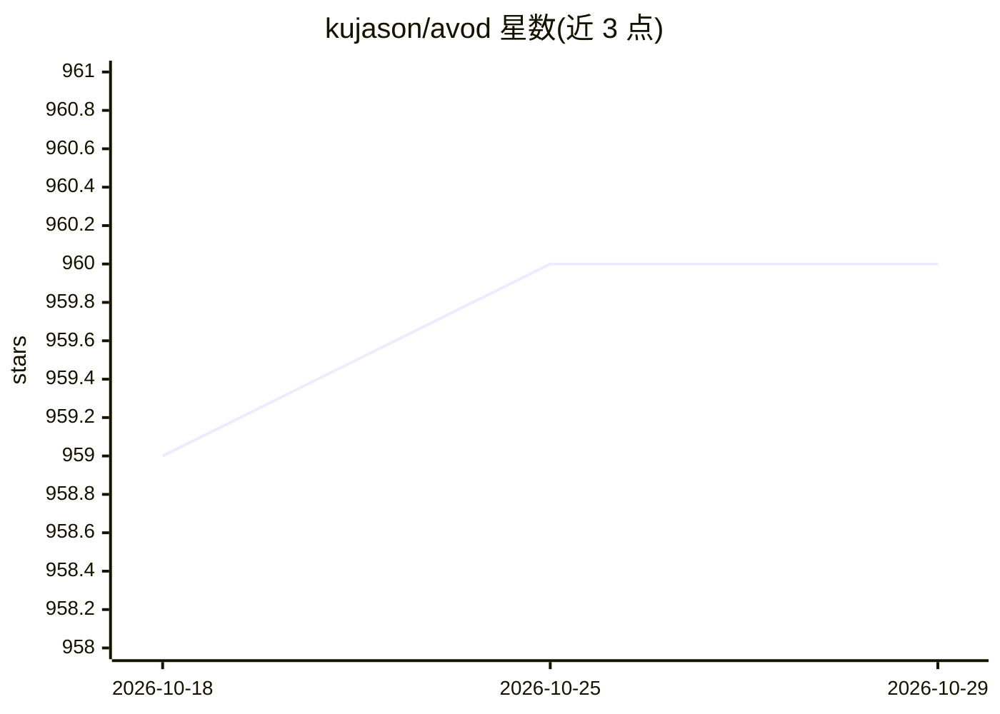

# kujason/avod

⭐ 960 · Python · MIT · 推送 2026-02-05 · [GitHub](https://github.com/kujason/avod) · 组织维护

**自动驾驶 3D 目标检测网络 AVOD 的官方实现**

多伦多大学团队（Ku 等，IROS 2018）发布的 AVOD / AVOD-FPN 网络的 Python 实现：聚合图像与鸟瞰图（BEV）特征进行 3D 候选框生成与目标检测，在 KITTI 数据集上训练/评估 Car、Pedestrian、Cyclist。提供数据预处理（mini-batch 生成）、Protobuf 配置驱动的训练、评估与推理脚本，以及 TensorBoard 与 2D 可视化工具。基于 TensorFlow 1.3.0 + Ubuntu 16.04 + Python 3.5 实现，需从源码克隆并编译积分图像库与 protobuf。

## 筛选速览

| 维度 | 判定 | 备注 |
|---|---|---|
| AI 角色 | `ai-native` | 本体是模型或模型工具 |
| 许可风险 | `permissive` | MIT |
| 部署形态 | `library` | 以包/库形式分发 |
| 模型依赖 | — | README 未给出锁定关系 |
| 硬件要求 | — | 无带数字的原话,不猜 |
| 安装摩擦 | `low` | 无编译、无系统依赖或容器化 |
| 成熟度 | — | 结构信号不足 |

## 能力要点

- 聚合图像与 BEV 特征的 3D 候选生成与检测（AVOD / AVOD-FPN）
- KITTI 数据集训练/评估/推理全流程脚本与配置体系
- 评估器可并行反复评估 checkpoint 并运行 KITTI 原生评估计算 AP
- 提供 TensorBoard 日志查看与检测结果 2D 可视化脚本

## 适用场景

- 在 KITTI 数据集上训练 3D 目标检测模型
- 复现论文中的 Car/Pedestrian/Cyclist 检测结果
- 对已有 checkpoint 运行推理并可视化预测

## 场景标签

`目标检测` · 领域:感知与多模态

## 证据(README 行号)

> L4: This repository contains the public release of the Python implementation of our Aggregate View Object Detection (AVO
> L12: @article{ku2018joint,
> L63: Implemented and tested on Ubuntu 16.04 with Python 3.5 and Tensorflow 1.3.0.

## 星数曲线

2026-10-18 959 → 2026-10-29 960（+1）

---
*卡片 v1 · prompt 1.4 · 生成 2026-10-21 · 置信度 mid · 依据 README sha `27744ded8e66` · [字段定义](../../DATASET.md)*
