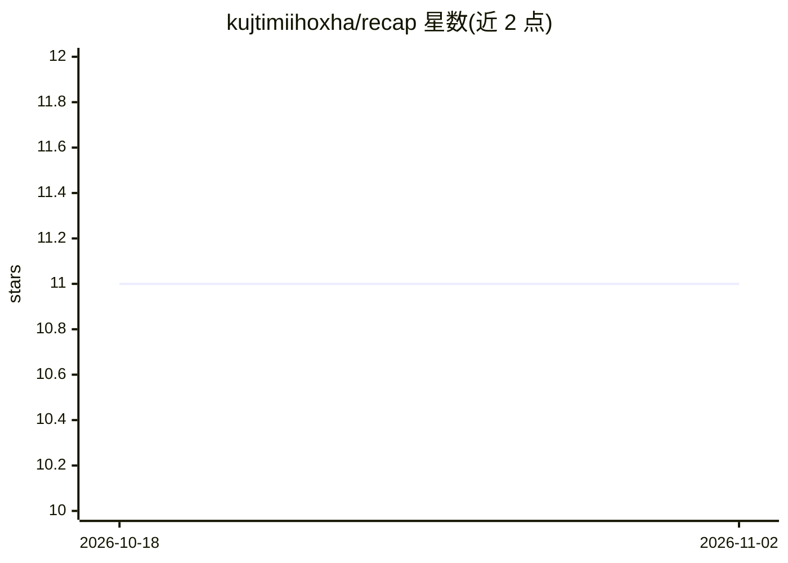

# kujtimiihoxha/recap

⭐ 11 · Go · MIT · 推送 2026-04-03 · [GitHub](https://github.com/kujtimiihoxha/recap) · 个人维护

**分析会议记录的 CLI agent：提取决议、责任人、期限与矛盾**

基于 Recursive Language Models 思路的命令行 agent，用于分析会议转录文档。文档加载进持久化 goja JavaScript 沙箱，agent 通过编写 JS 代码检索、切片文档，并用 llm_query 递归调用子 LLM 处理文本块，原始文本不进入上下文窗口；上下文达 90% 预算时自动摘要并重开。输出带来源引用的结构化结果：决议（含状态）、责任人、期限与跨文档矛盾。用 Go 编写，通过 go install 安装，需设置 OpenAI API key。

## 筛选速览

| 维度 | 判定 | 备注 |
|---|---|---|
| AI 角色 | `ai-native` | 本体是模型或模型工具 |
| 许可风险 | `permissive` | MIT |
| 部署形态 | `library` | 以包/库形式分发 |
| 模型依赖 | — | README 未给出锁定关系 |
| 硬件要求 | — | 无带数字的原话,不猜 |
| 安装摩擦 | `low` | 无编译、无系统依赖或容器化 |
| 成熟度 | — | 结构信号不足 |

## 能力要点

- 文档置于 goja JS 沙箱，agent 写代码检索而非直接注入上下文
- llm_query 递归调用子 LLM 处理特定文本块
- 上下文达 90% 预算时自动摘要，沙箱状态跨摘要边界持久保留
- 输出带来源引用的结构化 JSON（决议/责任人/期限/矛盾）

## 适用场景

- 从多份会议记录中提取决议、责任人与期限
- 发现跨文档之间的矛盾表述
- 针对文档集用自然语言提问并获带出处的回答

## 场景标签

`文档问答` · 领域:知识与检索

## 证据(README 行号)

> L5: A CLI agent that analyses meeting transcripts — extracts decisions, ownership, deadlines, and contradictions across 
> L9: Built as an exploration of Recursive Language Models (Zhang, Kraska & Khattab, 2025). The core idea from the paper i
> L17: 5. Results are returned as structured data: decisions (with status), owners, deadlines, and cross-document contradi

## 星数曲线

2026-10-18 11 → 2026-11-02 11（+0）

---
*卡片 v1 · prompt 1.4 · 生成 2026-11-02 · 置信度 high · 依据 README sha `e820a49d4c53` · [字段定义](../../DATASET.md)*
