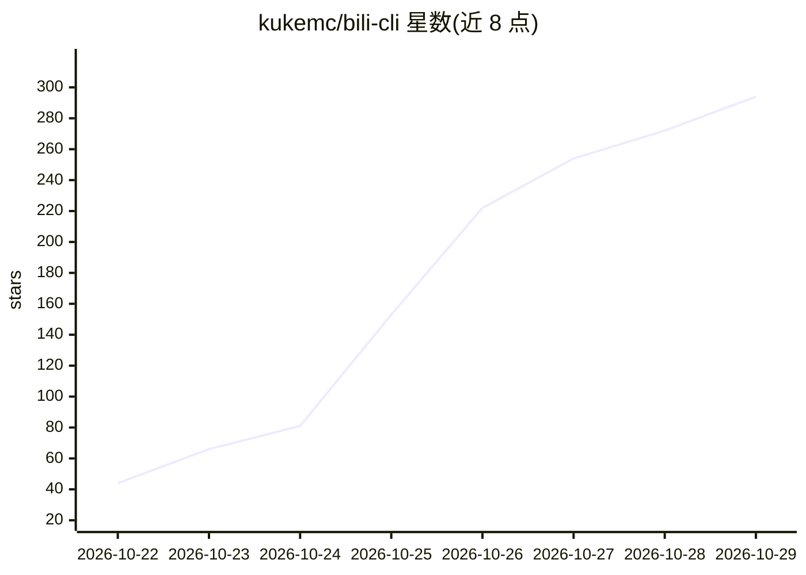

# kukemc/bili-cli

⭐ 294 · Python · MIT · 推送 2026-10-26 · [GitHub](https://github.com/kukemc/bili-cli) · 个人维护 · 中文 README

**给 AI Agent 用的哔哩哔哩命令行工具，JSON 输出全套账号操作**

面向 AI Agent 的 B 站 CLI（pip 包名 bili-agent）：提供 80+ 条命令与 17 个 MCP 工具，覆盖扫码登录、浏览推荐/热搜、看视频（字幕、AI 总结、抽帧、本地 Qwen3-ASR 语音转写）、评论/私信/动态/投稿/合集/弹幕、创作数据统计等，全部输出统一 JSON（含错误码与下一步提示）。通过 bili skills install 可自动装进 Claude Code、Codex、Cursor 等 18 个 Agent，也可作为 MCP 服务接入 Claude Desktop、Cherry Studio。内置本地限流、审计日志、投币每日上限、私信白名单、投稿默认勾选 AI 生成声明等安全护栏；声明为非官方项目，不提供绕过风控功能。需 Python 3.10+，ffmpeg 为可选依赖。

## 筛选速览

| 维度 | 判定 | 备注 |
|---|---|---|
| AI 角色 | `ai-ecosystem` | LLM/agent 周边工具 |
| 许可风险 | `permissive` | MIT |
| 部署形态 | `library` | 以包/库形式分发 |
| 模型依赖 | — | README 未给出锁定关系 |
| 硬件要求 | — | 无带数字的原话,不猜 |
| 安装摩擦 | `medium` | 含编译或系统依赖之一 |
| 成熟度 | — | 结构信号不足 |

## 能力要点

- 80+ 条命令 + 17 个 MCP 工具，统一 JSON 输出（含错误码与 hint）
- 一键安装进 18 个 Agent（Claude Code、Codex、Cursor、DeepSeek Harness 等）
- 本地 Qwen3-ASR 语音转写（GPU/CPU 自适应），无字幕视频自动转写
- 默认开启安全护栏：限流、审计日志、投币每日上限、私信白名单、--dry-run

## 适用场景

- 让 AI Agent 代替自己回复评论、私信和粉丝互动
- 让 Agent 自动投稿视频、发动态并跟踪审核状态与创作数据
- 通过 CLI 或 MCP 让 Agent 浏览和总结 B 站视频内容

## 场景标签

`语音识别` `网页抓取` · 领域:效率与自动化

## 证据(README 行号)

> L1: bili-cli：一句话，让你的 AI Agent 学会运营你的 B 站账号
> L37: 把 bili-cli 交给 Claude Code、Codex、Cursor、Gemini CLI、OpenClaw、DeepSeek Harness 或任何能执行命令的 Agent，它就变成一个**真正会玩 B 站的 Agent
> L102: - `bili skills install`：自动检测并装进 **Claude Code、Codex、Cursor、Gemini CLI、GitHub Copilot、Windsurf、OpenCode、OpenClaw、Qw

## 星数曲线

2026-10-22 44 → 2026-10-29 294（+250）

---
*卡片 v1 · prompt 1.4 · 生成 2026-10-24 · 置信度 high · 依据 README sha `9eef26ac6a6e` · [字段定义](../../DATASET.md)*
