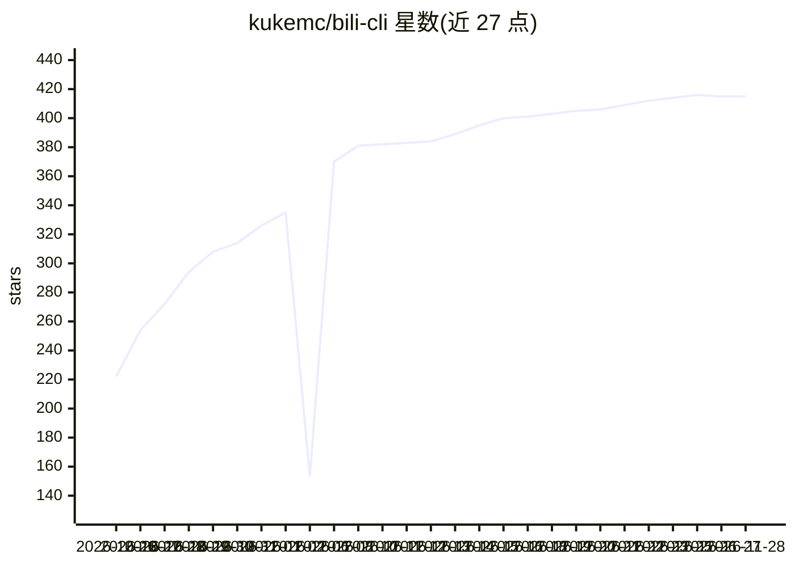

# kukemc/bili-cli

⭐ 415 · Python · MIT · 推送 2026-11-27 · [GitHub](https://github.com/kukemc/bili-cli) · 个人维护 · 中文 README

**让 AI Agent 操作 B 站账号的命令行工具：登录、看视频、评论、投稿**

为 AI Agent 设计的哔哩哔哩命令行工具，提供 80+ 条命令覆盖扫码登录、视频观看与信息获取、评论/私信/动态互动、投稿与改稿、数据中心查询。输出统一为 JSON（含错误码与下一步提示），写入操作内置本地限流、审计日志、投币上限、私信白名单与 AI 内容声明等护栏。可通过 skills install 自动装进 18 个 Agent，或以 17 个 MCP 工具接入 Claude Desktop 等客户端。需 Python 3.10+；语音转写依赖 Qwen3-ASR，可本地 GPU/CPU 部署或接云端接口。

## 筛选速览

| 维度 | 判定 | 备注 |
|---|---|---|
| AI 角色 | `ai-ecosystem` | LLM/agent 周边工具 |
| 许可风险 | `permissive` | MIT |
| 部署形态 | `library` | 以包/库形式分发 |
| 模型依赖 | — | README 未给出锁定关系 |
| 硬件要求 | — | 无带数字的原话,不猜 |
| 安装摩擦 | `medium` | 含编译或系统依赖之一 |
| 成熟度 | — | 结构信号不足 |

## 能力要点

- 80+ 条命令，统一 JSON 输出、错误码与 hint 下一步提示
- 自动装进 18 个 Agent，并提供 17 个 MCP 工具
- 默认限流、审计日志、投币每日上限、--dry-run 预览等安全护栏
- 无字幕视频可本地部署 Qwen3-ASR 转写（GPU/CPU）或接云端服务

## 适用场景

- 让 Claude Code/Codex 等 Agent 帮我管理 B 站消息并回复粉丝
- 用 Agent 自动投稿视频并跟踪审核与播放数据
- 让 Agent 看完视频后把有意思的发现私信告诉我

## 场景标签

`语音识别` · 领域:感知与多模态

## 证据(README 行号)

> L37: 把 bili-cli 交给 Claude Code、Codex、Cursor、Gemini CLI、OpenClaw、DeepSeek Harness 或任何能执行命令的 Agent，它就变成一个**真正会玩 B 站的 Agent
> L150: - **一条命令，一个 JSON**：成功 `{"ok": true, "data": …}`，失败 `{"ok": false, "error": {"code", "message", "hint"}}`，`hint` 直接
> L39: > 🧩 **80+ 条命令** · 🤖 **自动装进 18 个 Agent** · 🔌 **17 个 MCP 工具** · 🛡️ **默认带安全护栏** · 💻 **Windows / macOS / Linux**

## 星数曲线

2026-10-26 222 → 2026-11-28 415（+193）

---
*卡片 v1 · prompt 1.4 · 生成 2026-11-28 · 置信度 high · 依据 README sha `20c0069c513c` · [字段定义](../../DATASET.md)*
