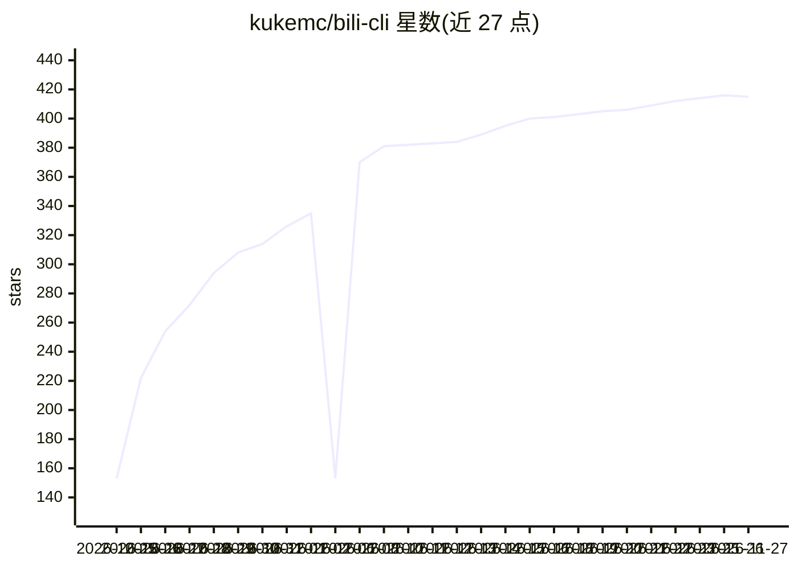

# kukemc/bili-cli

⭐ 415 · Python · MIT · 推送 2026-11-23 · [GitHub](https://github.com/kukemc/bili-cli) · 个人维护 · 中文 README

**给 AI Agent 用的 B 站运营 CLI：扫码登录到投稿全流程**

为可执行命令的 AI Agent 设计的哔哩哔哩命令行工具，覆盖扫码登录、看视频（含 B 站 AI 总结、字幕、抽帧总览图）、评论、真正的 @、私信、动态、投稿与改稿、合集管理、创作数据分析等 80+ 条命令。每条命令返回统一 JSON（含错误码与下一步提示），带本地限流、审计日志、投币每日上限、--dry-run、私信白名单、风控即停与防提示注入等默认护栏。可通过 bili skills install 装进 18 个 Agent，或以 17 个 MCP 工具接入不能执行命令的客户端。包名因 PyPI 占用为 bili-agent。

## 筛选速览

| 维度 | 判定 | 备注 |
|---|---|---|
| AI 角色 | `ai-ecosystem` | LLM/agent 周边工具 |
| 许可风险 | `permissive` | MIT |
| 部署形态 | `library` | 以包/库形式分发 |
| 模型依赖 | — | README 未给出锁定关系 |
| 硬件要求 | — | 无带数字的原话,不猜 |
| 安装摩擦 | `medium` | 含编译或系统依赖之一 |
| 成熟度 | — | 结构信号不足 |

## 能力要点

- 80+ 条命令，统一 JSON 输出、错误码与下一步提示
- bili skills install 自动装进 18 个 Agent，另有 17 个 MCP 工具
- 默认安全护栏：限流、审计日志、投币上限、--dry-run、风控即停
- 无字幕视频可本地部署 Qwen3-ASR 语音转写（GPU/CPU）或接云端

## 适用场景

- 让 Agent 查看并回复 B 站消息、私信，与粉丝互动
- 用 Agent 完成视频投稿、定时发布、改稿与合集管理
- 查询稿件完播率、互动率与账号数据做运营复盘
- 让 Agent 看懂视频内容并汇报给主人

## 场景标签

`语音识别` `工作流自动化` · 领域:效率与自动化

## 证据(README 行号)

> L37: 把 bili-cli 交给 Claude Code、Codex、Cursor、Gemini CLI、OpenClaw、DeepSeek Harness 或任何能执行命令的 Agent，它就变成一个**真正会玩 B 站的 Agent
> L106: - `bili skills install`：自动检测并装进 **Claude Code、Codex、Cursor、Gemini CLI、GitHub Copilot、Windsurf、OpenCode、OpenClaw、Qw
> L148: ## 🤖 为 Agent 而生的设计

## 星数曲线

2026-10-25 153 → 2026-11-27 415（+262）

---
*卡片 v1 · prompt 1.4 · 生成 2026-11-25 · 置信度 high · 依据 README sha `69aebd0ad25f` · [字段定义](../../DATASET.md)*
