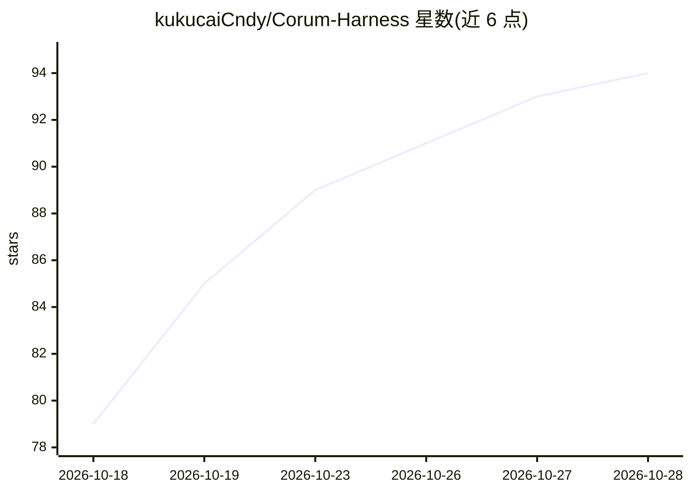

# kukucaiCndy/Corum-Harness

⭐ 94 · TypeScript · Apache-2.0 · 推送 2026-10-28 · [GitHub](https://github.com/kukucaiCndy/Corum-Harness) · 个人维护 · 中文 README

**基于 DeepSeek Harness 的桌面 Agent 产品，含编程工作台**

在 DeepSeek Harness（dsh）Agent 运行时内核之上构建的 Electron 桌面 Agent 产品：继承底座的 context 管理、工具系统、LLM 适配、会话存储与 subagent 机制，叠加 38 个自研插件。功能包括声明式多 Agent 编排（子 Agent 在独立 git worktree 工作并自动集成）、恒只读的指挥模式、Agent persona 预设、记忆底座、MCP 集成、本地 Ollama provider、本地文生图，以及 Monaco 编辑器 + 终端 + 对话区的编程工作台。开源部分为任务模式；项目模式闭源独立维护。打包链路当前面向 macOS（Apple Silicon）。

## 筛选速览

| 维度 | 判定 | 备注 |
|---|---|---|
| AI 角色 | `ai-native` | 本体是模型或模型工具 |
| 许可风险 | `permissive` | Apache-2.0 |
| 部署形态 | `desktop` | 安装包/桌面程序 |
| 模型依赖 | local-ok | 支持本地模型 |
| 硬件要求 | — | 无带数字的原话,不猜 |
| 安装摩擦 | `low` | 无编译、无系统依赖或容器化 |
| 成熟度 | `idea` | |

## 能力要点

- 多 Agent 编排：子 Agent 在独立 git worktree 工作并自动集成
- 指挥模式（Conductor Mode）：指挥者恒只读，三阶段调研与亲自验收
- 38 个插件按 ui/session/agent 分组，16 个 fork 包差异登记并由脚本守卫
- MCP 服务管理与授权，工具自动装配；支持 Ollama 本地 provider

## 适用场景

- 在桌面端以对话方式完成编程任务，配合 Monaco 编辑器与终端
- 用指挥模式带子 Agent 队伍做调研与验收
- 接入 MCP 服务与本地模型（如 Ollama）运行 Agent

## 场景标签

`编码 Agent` `多智能体` · 领域:Agent 开发

## 证据(README 行号)

> L20: Corum Harness 把 DeepSeek Harness 从一个 **Agent 运行时**，扩展成一个**可直接使用的 Agent 产品**：
> L26: 底座能力（context 管理、工具系统、LLM 适配、会话存储、subagent 机制）全部继承自 dsh；
> L44: - **文生图**：本地文生图能力（`corum-artgen`）。

## 星数曲线

2026-10-18 79 → 2026-10-28 94（+15）

---
*卡片 v1 · prompt 1.4 · 生成 2026-10-23 · 置信度 high · 依据 README sha `d3d0e6193d98` · [字段定义](../../DATASET.md)*
