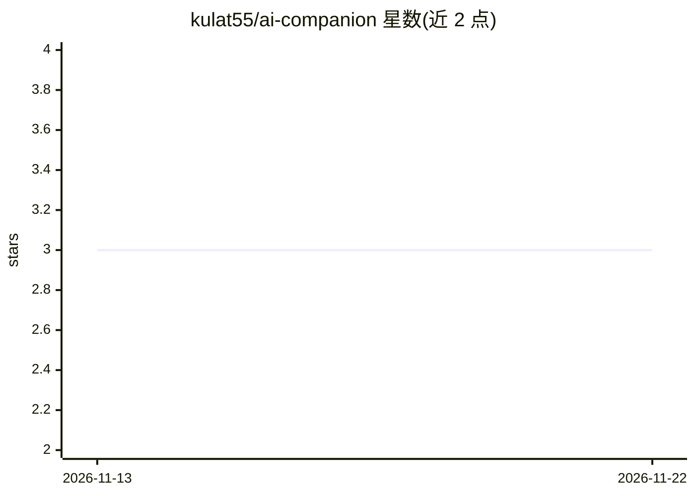

# kulat55/ai-companion

⭐ 3 · Python · MIT · 推送 2026-10-07 · [GitHub](https://github.com/kulat55/ai-companion) · 个人维护 · 中文 README

**Windows 本地 AI 伴侣：Letta 长期记忆+Live2D 桌宠+QQ 主动联系**

基于 Open-LLM-VTuber、Letta 与 Ollama 深度定制的本地 AI 伴侣项目，本仓库仅包含定制脚本、配置模板与手册，运行时自动 clone 上游 Open-LLM-VTuber。功能包括 Letta 三层长期记忆、自定义人格模板、时间与天气感知、定时主动发送 QQ 消息（NapCat 协议）、Live2D 桌宠、edge-tts 语音合成，以及网页管理面板（服务健康、模型切换、记忆编辑、历史检索）。面向 Windows 10/11 用户提供 PowerShell 一键安装脚本与启停管理脚本，对话模型可选 DeepSeek 云端或本地 Ollama qwen2.5。

## 筛选速览

| 维度 | 判定 | 备注 |
|---|---|---|
| AI 角色 | `ai-native` | 本体是模型或模型工具 |
| 许可风险 | `permissive` | MIT |
| 部署形态 | `desktop` | 安装包/桌面程序 |
| 模型依赖 | local-ok | 支持本地模型 |
| 硬件要求 | — | 无带数字的原话,不猜 |
| 安装摩擦 | `low` | 无编译、无系统依赖或容器化 |
| 成熟度 | — | 结构信号不足 |

## 能力要点

- Letta 三层记忆（核心记忆/对话历史/归档检索）与网页端记忆编辑
- 对话模型可选 DeepSeek 或本地 Ollama qwen2.5 离线备用
- 定时主动发送 QQ 消息（NapCat 协议框架）与每日天气写入记忆
- PowerShell 一键安装与全套启停/诊断/测试脚本

## 适用场景

- 在 Windows 电脑上搭建有长期记忆的本地 AI 伴侣
- 让 AI 角色定时通过 QQ 主动发消息维系联系
- 离线环境下用本地 qwen2.5 模型对话
- 自定义 AI 角色的人设与用户档案

## 场景标签

`AI 助手` · 领域:对话与助手

## 证据(README 行号)

> L3: 一个基于 Open-LLM-VTuber + Letta + Ollama 深度定制的 **本地 AI 伴侣** 项目。
> L5: 她是一个住在你电脑里的 AI 角色——有完整人设记忆（人格可自定义）、能感知时间和天气、会主动找你聊天（QQ）、有可视化桌宠和网页管理面板。

## 星数曲线

2026-11-13 3 → 2026-11-22 3（+0）

---
*卡片 v1 · prompt 1.4 · 生成 2026-11-21 · 置信度 high · 依据 README sha `7eb086ec9f24` · [字段定义](../../DATASET.md)*
