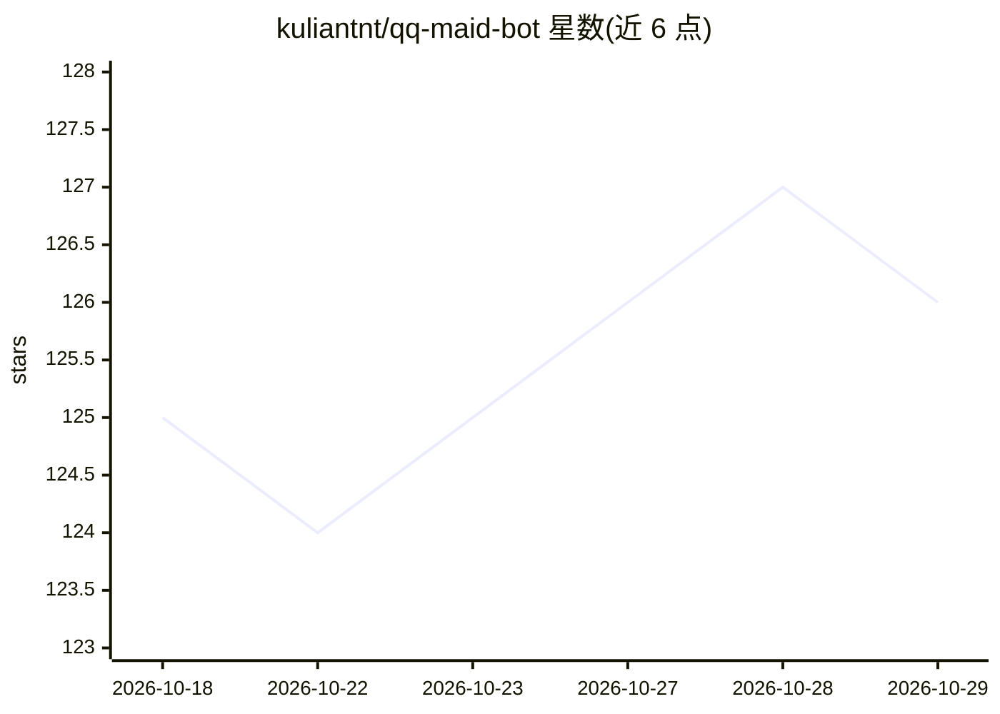

# kuliantnt/qq-maid-bot

⭐ 126 · Rust · MIT · 推送 2026-10-23 · [GitHub](https://github.com/kuliantnt/qq-maid-bot) · 个人维护 · 中文 README

**自托管多入口 AI Agent 聊天机器人（QQ/OneBot/微信）**

Rust 编写的单进程自托管聊天机器人，以 QQ 官方机器人为主要入口，支持 OneBot 11（主要面向 NapCat）和可选微信服务号文本入口。在同一进程内提供多轮会话、多模态图片理解、受控长期记忆（个人/群画像/群公共分域）、Todo 与提醒、RSS 订阅推送、本地 Markdown 知识检索、联网查询、Tool Calling 与多模型路由（OpenAI、Gemini、MiMo、DeepSeek 及 OpenAI-compatible，可候选链降级）。常驻内存约 25 MiB。配置通过 Web Console 或 .env 完成，模型只能调用服务端注册并按场景放行的工具。

## 筛选速览

| 维度 | 判定 | 备注 |
|---|---|---|
| AI 角色 | `ai-native` | 本体是模型或模型工具 |
| 许可风险 | `permissive` | MIT |
| 部署形态 | `desktop` | 安装包/桌面程序 |
| 模型依赖 | locked-api |  |
| 硬件要求 | — | 无带数字的原话,不猜 |
| 安装摩擦 | `low` | 无编译、无系统依赖或容器化 |
| 成熟度 | — | 结构信号不足 |

## 能力要点

- QQ 官方 / OneBot 11 / 微信服务号多入口接入
- 记忆分域管理（个人/群画像/群公共）与本地知识检索
- 多模型路由与候选链自动降级，支持 OpenAI-compatible Provider
- 内置 React 19 Web Console 配置中心与 /ops 白名单运维命令

## 适用场景

- 在 QQ 群/私聊里拥有带记忆和工具调用能力的 AI 助手
- 通过对话管理待办、提醒与 RSS 订阅推送
- 自托管一个低内存占用、数据不外流的个人聊天机器人

## 场景标签

`聊天机器人` `AI 助手` `Agent 记忆` · 领域:Agent 开发

## 证据(README 行号)

> L14: 项目使用 Rust 构建，当前以 QQ 官方机器人为主要入口，同时支持 OneBot 11 和可选的微信服务号文本入口。它在同一个进程中提供多轮会话、受控长期记忆、Todo 与提醒、RSS 推送、本地知识检索、联网查询、多模态理解
> L173: - **多模型路由**：支持 OpenAI、Gemini、MiMo、DeepSeek 和 OpenAI-compatible Provider，并可按候选链自动降级。DeepSeek 新部署默认使用 V4 Flash Respo
> L179: |QQ 官方机器人|主要入口|C2C、群聊、图片理解、引用上下文、流式回复和主动推送|

## 星数曲线

2026-10-18 125 → 2026-10-29 126（+1）

---
*卡片 v1 · prompt 1.4 · 生成 2026-10-23 · 置信度 high · 依据 README sha `df2258f288d8` · [字段定义](../../DATASET.md)*
